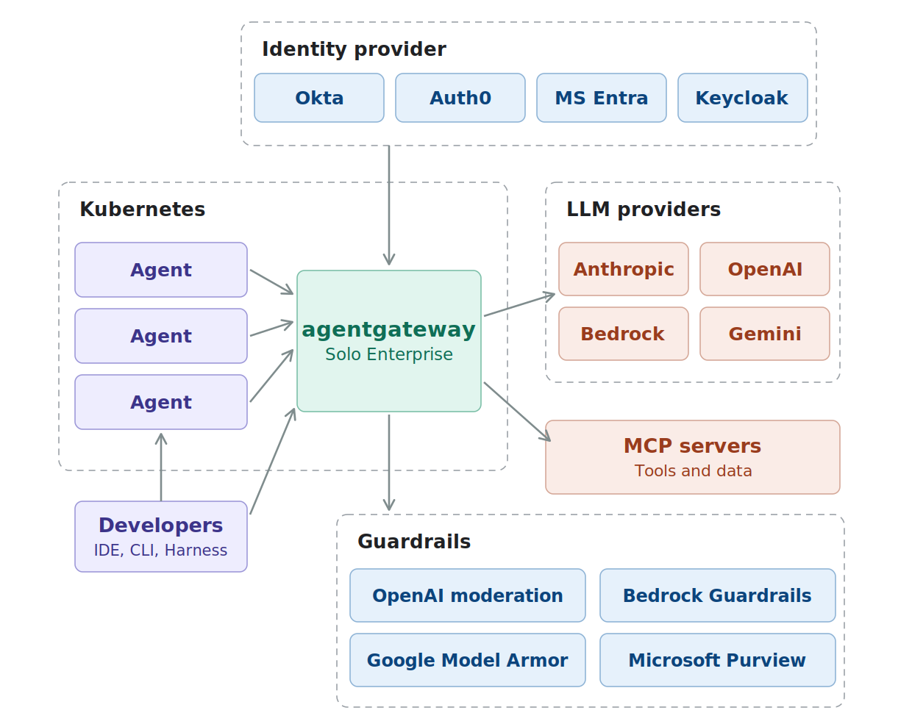
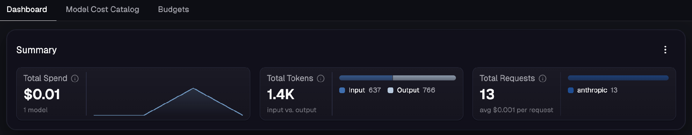
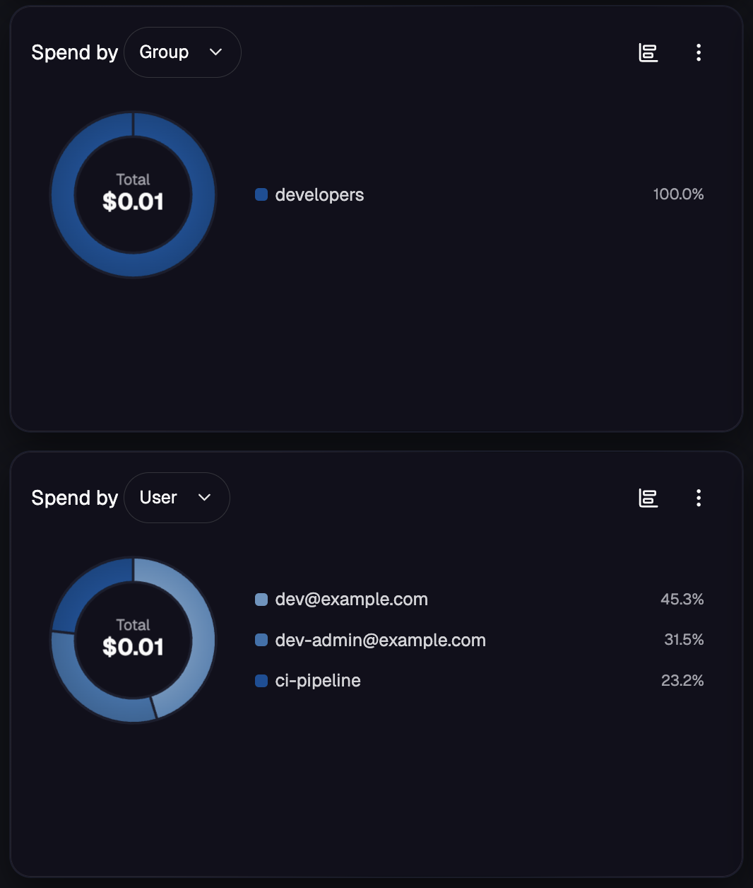

# Deployment Guide for Securing, Observing, and Controlling LLM Consumption on Kubernetes

**Updated:** August 10th, 2026

**Certified against:** Solo Enterprise for agentgateway v2026.7.1

# Introduction

Most AI platforms start the same way. A developer gets an API key, calls a provider directly, and ships something that works. Fast, pragmatic, entirely ungoverned. By the time a second team builds on that foundation the pattern has set: direct provider access, keys in environment variables, no idea what is being spent or by whom.

This is hard to undo later because the ungoverned path is the path of least resistance for every team that comes after. No team chooses sprawl. Sprawl accumulates, one reasonable decision at a time.

This deployment guide shows you how to bring that traffic under control without touching application code.

Solo Enterprise for agentgateway sits between your agents and your LLM providers and becomes the single point of control for that traffic. It enforces identity, applies policy, prices and attributes every request, and manages routing, while your applications keep calling a familiar API. When you want to move from one provider to another you change gateway configuration, not application code.

This guide is written for the engineer who will build and run the gateway, whether you are bringing governance to a sprawl of existing teams or evaluating the product for the first time. Every step is designed to be run in sequence, verified, and extended.

### What goes wrong on the ungoverned path

These are the failure modes of direct provider access. Each one is addressed by a step in this guide.

- **Access is all or nothing.** A provider key is a bearer token with no notion of who is calling. Anyone holding it reaches any model, at any volume, and nothing downstream can tell one caller from another.
- **Nothing inspects the payload.** Prompts carrying customer PII, and responses carrying content you would not put in front of a customer, both pass straight through.
- **There is no record.** When a response is questioned weeks later, there is no per-request account of who asked, which model answered, or what it cost.
- **Spend is discovered, not managed.** The first accurate number arrives on the provider invoice, unattributed, after the money is gone. There is no ceiling and no warning.
- **A provider outage is your outage.** One endpoint, no fallback, and moving to a different provider means changing application code in every service that calls a model.
None of these are exotic. They are what a platform looks like when nothing sits between the application and the provider.

### What you will build

- Verified caller identity on every request, from your existing IdP
- Access control determining which callers reach which models
- Guardrails filtering harmful content and PII before it reaches the provider
- Compliance-grade audit logs on every request, including the rejected ones
- Realized USD cost attributed per request and per user, and per group once your IdP emits a claim the group dimension can read (see Step 12)
- A cost dashboard your finance and platform teams can both read
- Budgets in dollars or tokens, enforced at the gateway, in audit or block mode
- Gateway-issued virtual keys for teams and tools with no IdP credentials
- Stable internal model names that survive provider migrations
- Automatic failover when a provider degrades
- Consistent default system prompt content applied to callers that do not supply their own


### How this guide is organized

**Up and Running** gets the gateway deployed, your first provider backend configured, and end-to-end routing verified. Nothing else works until this is done.

**Secure** builds the trust model: JWT authentication, group and role based authorization, content guardrails, and audit logging. Provider keys were already secured in Up and Running. Secure finishes the job on the caller side.

**Observe** turns identity into money. You price every request against a model cost catalog and get a dashboard showing spend by user and by group. By the end of this section you know exactly who is spending what. Nothing is being blocked yet, and that is deliberate.

**Control** sets the limits. Budgets, enforcement modes, virtual keys, model aliasing, failover, and prompt enrichment. The gateway stops being a secured proxy and becomes the authoritative layer for LLM traffic.

The order matters more than it looks. Identity has to exist before attribution means anything, and attribution has to exist before a budget is anything other than a guess. Each section is a prerequisite for the next.

## Version support

This Deployment Guide is pinned to **v2026.7.1** and every command, manifest, and documentation link uses that version.

Solo Enterprise for agentgateway has two release channels:

**Latest** releases continuously. Every release in this channel can include features and enhancements as well as bug fixes.

**LTS** releases quarterly. Subsequent releases on an LTS line are `patchN` and are limited to bug fixes and security patches, so the minor version does not increment.

This guide targets LTS. Every command, manifest and output here stays valid across the full patch stream of `v2026.7.1`, so you can take security and bug fixes without re-validating anything. Deployment Guides are updated when a new LTS drops, which is quarterly.

If you standardize on Latest instead, pin a specific version rather than using `latest`, and expect the outputs shown here to differ as features land.

Before you start, check the [version support page](https://docs.solo.io/agentgateway/2026.7.1/reference/versions/) and decide deliberately which version you are standardizing on.

## Environment setup

Set these before running anything. Every command below uses them, and setting them once here is what makes the rest of this guide copy-pasteable without hunting inside YAML for values you need to change.

```bash run id=environment-setup-env
# Pinned versions
export AGENT_GATEWAY_VERSION=v2026.7.1
export SOLO_UI_VERSION=0.5.3
export GATEWAY_API_VERSION=v1.6.1
export KEYCLOAK_VERSION=26.1.3

# Solo Enterprise license. Contact your Solo account team if you do not have one.
export AGENTGATEWAY_LICENSE_KEY='<your-license-key>'

# LLM provider. This guide uses Anthropic as the reference provider.
export ANTHROPIC_API_KEY='<your-anthropic-api-key>'
export LLM_PRIMARY_MODEL=claude-sonnet-4-6
export LLM_FALLBACK_MODEL=claude-haiku-4-5

# Content moderation provider, for the second guardrail layer in Step 8.
# Only needed if you use OpenAI Moderation. The regex layer needs no credentials,
# and Attachment E covers Bedrock Guardrails, Model Armor, Purview DLP and webhooks.
export OPENAI_API_KEY='<your-openai-api-key>'

# Identity provider. Keycloak is the reference implementation.
# See Attachment A if you need to stand one up.
export KEYCLOAK_URL=http://keycloak:8080
export KEYCLOAK_REALM=llm-platform
export KEYCLOAK_CLIENT_ID=agentgateway-client
export KEYCLOAK_CLIENT_SECRET=agentgateway-client-secret

# The IdP group allowed to reach the model.
# This MUST match a value in the groups claim of your token, exactly, including case.
export LLM_ALLOWED_GROUP=developers
```

### What you need before you start

| **Requirement** | **Needed for** | **Notes** |
|---|---|---|
| A Kubernetes cluster | Everything | Any conformant cluster. kind is fine and is what the lab assumes. |
| Solo Enterprise license key | Step 1 | Contact your Solo account team |
| An Anthropic API key | Step 2 onward | Or another provider, see Attachment C |
| An identity provider | Step 6 onward | Attachment A stands one up in one command |
| An OpenAI API key | Step 8, **optional** | Only for the OpenAI Moderation guardrail. The regex layer needs nothing, and Attachment E has alternatives. |
| `kubectl`, `helm`, `jq`, `curl` | Everything |  |
| `agctl` | Step 11, **optional** | Convenience for generating a cost catalog. It is experimental and not supported for production, and the catalog is plain JSON you can write yourself. Install steps are in Step 11.1. |
| A metrics backend | **Optional** | Nothing in this guide requires Prometheus. Attachment D covers collection and alerting if you want the telemetry in a stack you already run. |
| Docker | Attachment A | Only if you run the reference Keycloak |

Two of the variables above need your attention rather than a copy-paste.

`KEYCLOAK_URL` must be a URL that resolves **identically from your laptop and from inside the cluster**, and your tokens' `iss` claim must match it exactly. Attachment A explains why and how. This is the most common single cause of a working setup returning 401.

`LLM_ALLOWED_GROUP` must match your own IdP. The reference value `developers` comes from the Attachment A realm. If you are using your own IdP, set it to a group that actually appears in your tokens.

> [!WARNING]
> Use `curl -sS` rather than `curl -s` **throughout this guide.** Every read in these steps goes through a port-forward, and a port-forward that has died prints nothing and exits 7. An empty result then looks identical to a masked value, an absent metric or a clean pass. `-S` keeps curl quiet on success and makes it say so on failure. A rollout restart is the usual cause: the old forward does not die with the pod, it lingers holding the local port so a replacement cannot bind, and requests go to a dead endpoint.
>
> **If you paste these blocks into zsh, turn on comments first.** zsh is the default shell on macOS and does not allow `#` comments in an interactive session, so every commented line in this guide returns `command not found: #`. Run `setopt interactive_comments` once per shell, or paste without the comment lines.

### Ports used in this guide

| **Port** | **What** |
|---|---|
| 8080 | Keycloak, on your laptop |
| 8081 | agentgateway proxy, port-forwarded. `/llm` for people, `/llm-svc` for machine callers from Step 13. |
| 4000 | Solo UI, port-forwarded |
| 15020 | agentgateway proxy metrics, port-forwarded |

If you already have something on these, change them consistently. The gateway and Keycloak in particular cannot share a port, and a port mismatch between where you fetch tokens and where the gateway validates them will cause failures that look like authentication problems.

**Two kinds of change, and only one of them restarts anything:**

| **Change** | **Effect** |
|---|---|
| Policies, backends, budgets, secrets | Pushed to the proxy over xDS. Live in seconds, **no restart**, port-forwards survive. |
| `Gateway.spec.infrastructure`, Helm upgrades | Changes the deployment spec, so the **pod rolls** and port-forwards die |

So after applying a policy you do not need a rollout. Confirm with `kubectl get eagpol`, send a request, and if you want to see what the proxy actually loaded rather than what the controller accepted, `agctl proxy config` reads the live runtime configuration.

**Port-forwards die, more often than you expect.** Any change that rolls the proxy pod kills every forward pointing at it, including the Gateway patch in Step 11.3 and any Helm upgrade. The symptom is `Failed to connect to localhost port ...` immediately after a step that appeared to work, which reads as a broken step rather than a dropped tunnel. Define this now and re-run it whenever something refuses to connect:

```bash run id=ports-used-in-this-guide
forwards() {
  pkill -f "kubectl port-forward.*agentgateway-system" 2>/dev/null
  kubectl rollout status deployment/agentgateway-proxy -n agentgateway-system --timeout=60s
  kubectl port-forward deployment/agentgateway-proxy -n agentgateway-system 8081:80     >/dev/null 2>&1 &
  kubectl port-forward deployment/agentgateway-proxy -n agentgateway-system 15020:15020 >/dev/null 2>&1 &
  kubectl port-forward service/solo-enterprise-ui  -n agentgateway-system 4000:80       >/dev/null 2>&1 &
  sleep 2
  echo "forwards up: gateway 8081, metrics 15020, ui 4000"
}
```

The `pkill` pattern is scoped to this namespace, but it will close any other forward you have open against it.

## How policies work

Worth ninety seconds now to save you an hour later.

You will create several `EnterpriseAgentgatewayPolicy` resources as you work through this guide. They are not independent. When multiple policies apply to the same resource, agentgateway merges them with a **shallow, field-level merge**. Two policies setting different fields both apply. Two policies setting the same field do not merge: the more specific target wins, and on a tie the result depends on creation order, with both policies reporting `ACCEPTED` and no error to tell you one is doing nothing.

That last sentence is the one that costs people time. A policy that silently does nothing looks exactly like a policy that is working.

Three practical consequences, which this guide follows throughout:

**One field, one policy.** If two things belong to the same field, they go in one policy. Guardrails are the example you will hit in Step 8: OpenAI Moderation and regex filters are both guardrail configuration, so they are configured together rather than in two resources that would fight.

**A policy targets one kind of resource.** Every entry in `targetRefs` must be the same `kind`. You cannot target a Gateway and an HTTPRoute in the same policy, so some separation is forced rather than chosen.

**Different concerns live in different sections,** and each section can only target certain resources:

| **Section** | **What it covers** | **Valid targets** |
|---|---|---|
| `frontend` | Listener behavior, access logs, tracing, metric attributes | Gateway only |
| `traffic` | Authentication, authorization, rate limits, budget enforcement | Gateway, HTTPRoute, GRPCRoute, ListenerSet |
| `backend` | Provider connection, AI behavior, backend TLS and health | Gateway, HTTPRoute, Service, EnterpriseAgentgatewayBackend |

Policies targeting the same resource with **different** fields all take effect, and each reports `ATTACHED=True`. You can verify this at any point with `kubectl get eagpol`, which shows an `ACCEPTED` and an `ATTACHED` column per policy.

**A policy targets its own namespace only.** `targetRefs` has no `namespace` field, so a policy and the route or Gateway it applies to must live together. Note the asymmetry: a `backendRef` inside a policy does take a namespace, so you can reference a backend elsewhere while only ever targeting locally.

Invalid targeting is rejected by the API server rather than silently ignored, and unknown fields are rejected too, so a typo or a stale field name fails immediately with the offending path named. Use this: `kubectl apply --dry-run=server` validates a manifest fully without creating anything, and it reports every unknown field at once rather than one per attempt. Silent overwriting between two valid policies is the failure mode to watch for, not silent misconfiguration.

> [!WARNING]
> **Two CRD sets are installed and they look almost identical.** `kubectl api-resources` shows both `agentgateway.dev` kinds (`AgentgatewayPolicy`, `AgentgatewayBackend`, `AgentgatewayParameters`) and `enterpriseagentgateway.solo.io` kinds (`EnterpriseAgentgatewayPolicy`, and so on). The Enterprise kinds are a superset. **Everything in this guide uses the Enterprise kinds.** An open source example found elsewhere, or suggested by an assistant, will apply cleanly while silently lacking the enterprise fields you need. If a policy applies without error and then appears to do nothing, check the `apiVersion` before anything else.

There is a fixed processing order too, which becomes relevant in Step 14. We come back to it in the validation section, once you have all the pieces to map onto it.

## UP AND RUNNING

Before you can secure, observe, or control anything, you need the gateway running and routing traffic to a provider. This section gets you there.

A working baseline is dramatically easier to debug than a half-configured system, so if something breaks later, come back here and confirm this still works before you start changing policy.

**What you are going to do:** install the CRDs and control plane, create a Gateway, store your provider key in a Secret, connect a backend, expose it on a route, install the Solo UI, and prove a request gets through.

**What you will have that you did not have before:** one place where all LLM traffic goes, and a provider key that has left your application and now lives somewhere you can rotate.

### Step 1: Deploy the agentgateway proxy

Install the Kubernetes Gateway API CRDs first. agentgateway uses the Gateway API as its routing primitive, so these have to be present before the control plane.

```bash run id=step-1-deploy-the-agentgateway
kubectl apply -f https://github.com/kubernetes-sigs/gateway-api/releases/download/${GATEWAY_API_VERSION}/standard-install.yaml
```

Install the Solo Enterprise for agentgateway CRDs:

```bash run id=helm-enterprise-agentgateway-crds
helm upgrade -i enterprise-agentgateway-crds \
  oci://us-docker.pkg.dev/solo-public/enterprise-agentgateway/charts/enterprise-agentgateway-crds \
  --create-namespace \
  --namespace agentgateway-system \
  --version ${AGENT_GATEWAY_VERSION}
```

Install the control plane. This uses a values file rather than only `--set` flags, for a reason explained below:

```bash run id=helm-enterprise-agentgateway
cat > agentgateway-values.yaml <<'EOF'
# Cost attribution dimensions. Only the order of jwt.email and jwt.sub differs
# from the chart default: email first, so dashboards and budgets identify
# callers by address rather than by an opaque UUID. Step 12 explains the
# tradeoff, and why the rest of this list should be left alone.
budgetDimensions:
  config:
    attributes:
      - id: virtualKey
        displayName: Virtual Key
        expression: apiKey.id
    hierarchy:
      - id: group
        displayName: Group
        expression: coalesce(jwt.group, apiKey.group)
      - id: user
        displayName: User
        expression: >-
          coalesce(apiKey.user, apiKey.name, apiKey.owner,
                   jwt.email, jwt.sub, basicAuth.username,
                   source.identity.namespace + "/" + source.identity.serviceAccount,
                   source.subjectCn)
EOF

helm upgrade -i enterprise-agentgateway \
  oci://us-docker.pkg.dev/solo-public/enterprise-agentgateway/charts/enterprise-agentgateway \
  --namespace agentgateway-system \
  --version ${AGENT_GATEWAY_VERSION} \
  --set-string licensing.licenseKey=${AGENTGATEWAY_LICENSE_KEY} \
  -f agentgateway-values.yaml
```

> [!WARNING]
> **Why a values file.** The `user` expression contains commas, and `helm --set` treats commas as value separators, so passing this with `--set` produces a mangled expression rather than an error. A values file is the only practical way to set it. Keep the file: you will want it for upgrades, and it is the thing that makes this configuration survive them.
>
> **Why change the default at all.** The chart's default resolves callers to `jwt.sub`, an opaque UUID. That is the safer choice for enforcement and a poor one for a dashboard anybody looks at. Putting `jwt.email` first makes attribution readable while keeping `jwt.sub` immediately behind it as the fallback, so a caller with no email claim still attributes rather than disappearing. Everything else in the list is unchanged, deliberately: the `apiKey.*` entries matter once you issue virtual keys in Step 13, and the workload identity and mTLS entries are how in-cluster agent traffic attributes without any token at all. Step 12 has the full reasoning.

Verify the control plane is running:

```bash run id=step-1-deploy-the-agentgateway-get-pods
kubectl get pods -n agentgateway-system
```

You should see something like this, though at this point without the proxy or the management components:

```text
NAME                                                        READY   STATUS
enterprise-agentgateway-...                                 1/1     Running
ext-auth-service-enterprise-agentgateway-...                1/1     Running
ext-cache-enterprise-agentgateway-...                       1/1     Running
rate-limiter-enterprise-agentgateway-...                    1/1     Running
waf-server-enterprise-agentgateway-...                      1/1     Running
```

What arrived without being asked for. `ext-auth-service` handles the authentication in Step 6 and Step 13. `rate-limiter` and `ext-cache` are what budgets compile down to in Step 14, which is why that step needs no additional infrastructure. The data plane proxy does not exist yet: it is created when you deploy a Gateway, below.

Create the Gateway:

```bash run id=gateway-agentgateway-proxy
kubectl apply -f- <<EOF
apiVersion: gateway.networking.k8s.io/v1
kind: Gateway
metadata:
  name: agentgateway-proxy
  namespace: agentgateway-system
spec:
  gatewayClassName: enterprise-agentgateway
  listeners:
    - name: http
      protocol: HTTP
      port: 80
      allowedRoutes:
        namespaces:
          from: All
EOF
```

Verify:

```bash run id=step-1-deploy-the-agentgateway-get-gateway
kubectl get gateway agentgateway-proxy -n agentgateway-system
kubectl get deployment agentgateway-proxy -n agentgateway-system
```

`PROGRAMMED: True` confirms the control plane pushed configuration to the proxy. If it still says `False` after two minutes, check the control plane logs:

```bash run id=step-1-deploy-the-agentgateway-logs-n when=manual
kubectl logs -n agentgateway-system deployment/enterprise-agentgateway
```

### Step 2: Store your provider API key

Provider keys belong in Kubernetes Secrets. Not in backend config, not in environment variables, not in application code.

Secrets give you three things the alternatives do not: namespace-level RBAC on who can read the key, rotation without redeployment, and a key that never sits in plain text in a manifest you might commit.

```bash run id=secret-anthropic-api-key
kubectl apply -f- <<EOF
apiVersion: v1
kind: Secret
metadata:
  name: anthropic-api-key
  namespace: agentgateway-system
type: Opaque
stringData:
  Authorization: ${ANTHROPIC_API_KEY}
EOF
```

The key name is `Authorization`, not `apiKey`. This matters and it is easy to get wrong.

Verify:

```bash run id=step-2-store-your-provider-api-key-get-secret
kubectl get secret anthropic-api-key -n agentgateway-system
```

**On rotation:** update the Secret and the gateway picks it up. No pod restarts, no config change, no redeployment. This is the main operational reason to use Secrets rather than anything else. Demonstrate it to whoever currently owns key rotation.

> [!WARNING]
> Using a different provider? See Attachment C for backend configuration for OpenAI, Azure OpenAI, Amazon Bedrock, Gemini, and Vertex AI. Each ends with a pointer back to Step 3.

### Step 3: Connect a backend and expose it on a route

An `EnterpriseAgentgatewayBackend` defines the connection to a provider. An `HTTPRoute` exposes it at a path. Together they are the routing layer: applications call a path on the gateway, and the gateway handles the provider connection and translates between message formats.

The provider migration story starts here. If your agents were built against the OpenAI API they send OpenAI-format requests, and the gateway translates them to Anthropic's format. Your application code does not change.

Create the backend:

```bash run id=backend-anthropic-claude-sonnet-backend
kubectl apply -f- <<EOF
apiVersion: enterpriseagentgateway.solo.io/v1alpha1
kind: EnterpriseAgentgatewayBackend
metadata:
  name: anthropic-claude-sonnet-backend
  namespace: agentgateway-system
spec:
  ai:
    provider:
      anthropic:
        model: "${LLM_PRIMARY_MODEL}"
  policies:
    auth:
      secretRef:
        name: anthropic-api-key
EOF
```

Create the route. It serves a readable path at `/llm` and rewrites to the provider's standard chat completions path, so an application using an OpenAI SDK only has to change its base URL:

```bash run id=route-anthropic-claude-sonnet
kubectl apply -f- <<EOF
apiVersion: gateway.networking.k8s.io/v1
kind: HTTPRoute
metadata:
  name: anthropic-claude-sonnet
  namespace: agentgateway-system
spec:
  parentRefs:
    - name: agentgateway-proxy
      namespace: agentgateway-system
  rules:
    - matches:
        - path:
            type: PathPrefix
            value: /llm
      filters:
        - type: URLRewrite
          urlRewrite:
            path:
              type: ReplacePrefixMatch
              replacePrefixMatch: /v1/chat/completions
      backendRefs:
        - group: enterpriseagentgateway.solo.io
          kind: EnterpriseAgentgatewayBackend
          name: anthropic-claude-sonnet-backend
          namespace: agentgateway-system
EOF
```

> [!WARNING]
> **Pinning** `model` **on the backend makes it authoritative.** With `spec.ai.provider.anthropic.model` set, the `model` field in the caller's request is **discarded**. A request asking for a different model gets the pinned one. A request asking for a model that does not exist gets the pinned one too, with a 200 and no error.
>
> This is a governance control: **your applications cannot use a model you have not approved, whatever they send.** Model allowlisting by construction, without asking a single team to change code. If you want callers to choose their own model, leave `model` unset, which is what Step 15 does for aliasing.
>
> The behaviour is silent. An invalid or unapproved model name produces no error, so a team can be entirely wrong about which model they are using. And the access log's `gen_ai.request.model` records the **resolved** model rather than the requested one, so there is no record anywhere of what the caller actually asked for and no way to detect the mismatch from telemetry. If you pin models, tell your application teams that you have, because they cannot discover it themselves.

**Names matter from here on.** Every policy in this guide targets the HTTPRoute `anthropic-claude-sonnet`. The backend is `anthropic-claude-sonnet-backend`. They are deliberately different, because a policy that targets a name which does not exist is silently ignored and you get no error to tell you why nothing is being enforced.

Verify both were accepted:

```bash run id=step-3-connect-a-backend-and-get-enterpriseagentgatewaybackend
kubectl get enterpriseagentgatewaybackend anthropic-claude-sonnet-backend -n agentgateway-system
kubectl get httproute anthropic-claude-sonnet -n agentgateway-system
```

The backend prints `ACCEPTED: True`. The route prints no conditions at all: `kubectl get httproute` shows name, hostnames and age, because a route's conditions are recorded against each parent Gateway rather than on the route itself. Read them with:

`kubectl get httproute anthropic-claude-sonnet -n agentgateway-system -o jsonpath='{range .status.parents[*]}{range .conditions[*]}{.type}={.status} {end}{end}'`

**Verified on v2026.7.1:**

```text
Accepted=True ResolvedRefs=True
```

`ResolvedRefs=False` is the one worth knowing: the backend name or namespace in `backendRefs` does not match an existing resource, and the route still reports `Accepted`. A route has no `Programmed` condition. That one belongs to the Gateway, and Step 1 is where you read it.

### Step 4: Install the Solo UI

Install it now rather than later, because it is how you will watch each layer appear as you build it.

Cost management is off by default and you want it on. Turning it on now avoids coming back to upgrade the release halfway through Observe.

```bash run id=helm-management
helm upgrade -i management \
  oci://us-docker.pkg.dev/solo-public/solo-enterprise-helm/charts/management \
  --namespace agentgateway-system \
  --create-namespace \
  --version ${SOLO_UI_VERSION} \
  --set cluster="mgmt-cluster" \
  --set products.agentgateway.enabled=true \
  --set "products.agentgateway.features.cost-management=true" \
  --set-string licensing.licenseKey=${AGENTGATEWAY_LICENSE_KEY}
```

> [!WARNING]
> **Consider** `cost-management-writes: false`**, and not only for access control.** Add `--set "products.agentgateway.features.cost-management-writes=false"` and the UI shows spend, budgets and keys but cannot modify them.
>
> It gives finance or FinOps visibility without change rights, and it prevents UI edits to the cost **dimensions**, which are Helm-managed platform configuration: an edit there is overwritten by the next `helm upgrade`, and in testing on v2026.7.1 saving a reordered expression through the UI silently dropped most of its fallback arguments, breaking attribution for every caller and, because the same dimension keys budget subjects, silently disabling budget enforcement with it.
>
> If you manage this platform through Helm or GitOps, turn writes off. Manage dimensions and budgets as code, and treat the UI as the way people read them.

Port-forward and open it:

```bash run id=step-4-install-the-solo-ui
kubectl port-forward service/solo-enterprise-ui -n agentgateway-system 4000:80 &
sleep 2
```

Open `http://localhost:4000/age/`. Note the `/age/` path.

You should see your `agentgateway-proxy` Gateway, your `anthropic-claude-sonnet` route, and your backend.

**Verify what you installed with Helm, not with the UI:**

```bash run id=step-4-install-the-solo-ui-2
helm list -n agentgateway-system
```

```text
NAME                          CHART                                   APP VERSION
enterprise-agentgateway       enterprise-agentgateway-v2026.7.1       2026.7.1
enterprise-agentgateway-crds  enterprise-agentgateway-crds-v2026.7.1  2026.7.1
management                    management-0.5.2
```

The UI reports the same version you pinned. If it does not, you are almost certainly looking at a cached build: reload in a private browsing window before treating it as a failed install. `helm list` is the authority for what is actually deployed.

**Come back here at the end of each section.** After Secure you will see caller identity on requests. After Observe, spend and cost attribution. After Control, budgets with live usage. The point of installing it now is that you get to watch that happen rather than being told about it.

### Step 5: Verify end-to-end routing

Port-forward the proxy:

```bash run id=step-5-verify-end-to-end-routing
kubectl port-forward deployment/agentgateway-proxy -n agentgateway-system 8081:80 &
sleep 2
```

The `sleep` matters if you are working through this quickly. A port-forward takes a moment to establish, and a request fired immediately after backgrounding it fails with a connection error that looks like a configuration problem.

Send a request in OpenAI format. The gateway translates it to Anthropic:

```bash run id=step-5-verify-end-to-end-routing-curl
curl http://localhost:8081/llm \
  -H "Content-Type: application/json" \
  -d "{
    \"model\": \"${LLM_PRIMARY_MODEL}\",
    \"messages\": [{\"role\": \"user\", \"content\": \"Reply with: gateway is working\"}]
  }"
```

Expected output, reformatted for readability:

```json
{
  "model": "claude-sonnet-4-6",
  "service_tier": "standard",
  "usage": {
    "prompt_tokens": 13,
    "completion_tokens": 6,
    "total_tokens": 19,
    "prompt_tokens_details": {
      "cached_tokens": 0,
      "cache_write_tokens": 0
    },
    "cache_read_input_tokens": 0,
    "cache_creation_input_tokens": 0
  },
  "choices": [
    {
      "message": {
        "content": "gateway is working",
        "role": "assistant"
      },
      "index": 0,
      "finish_reason": "stop"
    }
  ],
  "id": "msg_011Cdqf3JkwA28ZoYM7CqHRN",
  "created": 1786209232,
  "object": "chat.completion"
}
```

You sent an OpenAI-format request. You received an OpenAI-format response, with `choices[].message` and `object: chat.completion`, from an Anthropic model. Your application does not know or care which provider answered. Note the `id` is Anthropic's own `msg_...` format passed through, so this was a real upstream call rather than anything synthesised at the gateway.

Three things to confirm:

- **HTTP 200.** The request reached the provider and came back.
- **The** `model` **field.** Confirms which model answered, which matters when you add aliasing in Step 15.
- **The** `usage` **block.** This is what the observability and cost pipeline consumes in Steps 10 through 12. Note it carries cache token counts in both OpenAI style (`prompt_tokens_details.cached_tokens`, `cache_write_tokens`) and Anthropic style (`cache_read_input_tokens`, `cache_creation_input_tokens`). Those are the fields the `cacheRead` and `cacheWrite` rates in your cost catalog price against, and on a caching workload they are where most of the difference between estimated and real spend lives.
Check the proxy handled it:

```bash run id=step-5-verify-end-to-end-routing-logs-deployment-agentgateway-proxy
kubectl logs deployment/agentgateway-proxy -n agentgateway-system --tail=20
```

**If you get a 404,** the route is not matching. Check the path in your curl against the `PathPrefix` value, including the leading slash.

**If you get a 401 or 403 from the provider,** the key in your Secret is wrong. Test it directly against the Anthropic API, then update the Secret.

**If you get connection refused,** the port-forward dropped. Re-run it.

The gateway is routing traffic. Everything from here attaches to this without touching the application that made that request.

**What you now have:** a single ingress point for LLM traffic, a provider key that lives in Kubernetes rather than in an application, and a UI showing you what is configured. What you do not have yet is any idea who is calling. That is next.

## SECURE

Your provider keys are already safe. They went into a Secret in Step 2 and have not left the cluster since. This section handles the other side of the connection: who is allowed to call the gateway, what they are allowed to reach, what content is permitted through, and what gets written down.

The reason this comes before Observe is not sequencing preference. Without verified identity, your telemetry has no subject. You can measure how many tokens were consumed but not by whom, which tells you that you have a problem without telling you where it is. Identity is what turns a number into an owner.

**What you are going to do:** validate tokens from your IdP at the gateway, restrict model access by group, filter prompts and responses, and confirm every request is being logged including the ones you reject.

**What you will have that you did not have before:** a request that cannot reach your provider without a verified caller attached to it.

> [!WARNING]
> **Identity provider.** Keycloak is the reference implementation. If you need to stand one up for a lab or PoC, Attachment A does it in one command and explains the one configuration detail that catches everyone. If you are using Okta, Entra ID, or Auth0 in production, Attachment B has the configuration delta and the settings to change in a realm you already have.

### Step 6: Authenticate callers with JWT

Right now anyone who can reach the gateway can call your provider on your key. No identity, no accountability, no way to apply policy per caller. This step closes that.

agentgateway validates JWTs at the gateway layer. Every request has to carry a valid bearer token from your IdP, and requests without one are rejected before the provider is contacted, so they cost nothing.

#### 6.1 Confirm your IdP is reachable and note the exact issuer URL

```bash run id=6-1-confirm-your-idp-is-reachable-curl
curl ${KEYCLOAK_URL}/realms/${KEYCLOAK_REALM}/protocol/openid-connect/certs
```

You should get JSON with a `keys` array. A 404 means the realm name is wrong. A timeout or connection refused means the URL is not reachable, and if it is reachable from your laptop but not from the cluster you have the problem Attachment A exists to solve.

**This constraint** causes more failed setups than everything else in this guide combined:

> [!WARNING]
> The URL in `KEYCLOAK_URL` has to resolve identically from your laptop and from inside the cluster, and the `iss` claim in your tokens has to match it exactly. The gateway fetches signing keys from that URL and compares it to the `iss` claim in every token. If you obtain a token through one hostname and configure the gateway with another, you will get HTTP 401 while holding a token that decodes perfectly.

#### 6.2 Get two tokens and look at them

Do this before applying any policy. It takes a minute and it tells you whether the next three steps can possibly work.

**What the rest of this guide needs from you is two tokens:**

| **Variable** | **Must be** |
|---|---|
| `ALLOWED_TOKEN` | A caller **in** the group named by `LLM_ALLOWED_GROUP` |
| `DENIED_TOKEN` | A caller **not** in that group |

How you obtain them is your business. Every verification step from here on uses those two variables and cares about nothing else. Two callers rather than one is not optional: a policy you have only tested in the passing direction is not tested.

**If you are using your own IdP,** get tokens however your provider requires and export them:

```bash run id=6-2-get-two-tokens-and-look-at-env when=manual
export ALLOWED_TOKEN='<a token for a caller in your allowed group>'
export DENIED_TOKEN='<a token for a caller in a different group>'
```

**If you are using the reference Keycloak from Attachment A,** this helper fetches them. It is specific to a Keycloak realm using the password grant, so treat it as lab convenience rather than something to carry into production:

```bash run id=6-2-get-two-tokens-and-look-at
get_token() {
  local user="${1:?usage: get_token <username> [password]}"
  local pass="${2:-${user}-password}"
  : "${KEYCLOAK_URL:?not set. See Environment setup.}"
  : "${KEYCLOAK_REALM:?not set. See Environment setup.}"
  : "${KEYCLOAK_CLIENT_ID:?not set. See Environment setup.}"
  : "${KEYCLOAK_CLIENT_SECRET:?not set. See Environment setup.}"
  curl -s -X POST "${KEYCLOAK_URL}/realms/${KEYCLOAK_REALM}/protocol/openid-connect/token" \
    -H "Content-Type: application/x-www-form-urlencoded" \
    -d "grant_type=password" \
    -d "client_id=${KEYCLOAK_CLIENT_ID}" \
    -d "client_secret=${KEYCLOAK_CLIENT_SECRET}" \
    -d "username=${user}" \
    -d "password=${pass}" \
    | jq -r '.access_token'
}

export ALLOWED_TOKEN=$(get_token dev)
export DENIED_TOKEN=$(get_token agent)
```

The password defaults to `<username>-password`, which is the convention in the reference realm, and takes an explicit second argument for anything else: `get_token alice 's3cret'`.

The four `: "${VAR:?...}"` lines are there because without them an unset variable becomes an empty POST field, your IdP returns an error object, and `jq -r '.access_token'` renders it as `null`. You would then be debugging a token that was never requested properly. With the guards, the shell names the missing variable and stops.

**Then decode both,** because the obvious one-liner for this does not work:

```bash run id=6-2-get-two-tokens-and-look-at-2
decode_jwt() {
  if [ -z "${1}" ]; then
    echo "decode_jwt: empty token. Did the fetch actually succeed?" >&2
    return 1
  fi
  echo "${1}" | cut -d. -f2 | tr '_-' '/+' \
    | awk '{n=length($0)%4; printf "%s%s", $0, (n ? substr("===",1,4-n) : "")}' \
    | base64 -d | jq .
}

decode_jwt "${ALLOWED_TOKEN}" | jq '{iss, aud, sub, preferred_username, email, groups, roles}'
decode_jwt "${DENIED_TOKEN}"  | jq '{iss, aud, sub, preferred_username, email, groups, roles}'
```

> [!WARNING]
> **Why not just** `base64 -d`**.** JWTs use base64url with no padding, so a payload whose length is not a multiple of four will not decode cleanly, and base64url uses `-` and `_` where base64 expects `+` and `/`. The two implementations then fail differently. GNU `base64` errors with `invalid input`. BSD `base64`, which is what macOS ships, **silently drops the incomplete final group**, so you get output that looks complete but is missing its last character or two, usually the closing `"}`. Readable by eye, invalid to `jq`, and no error either way. The helper adds the padding and translates the characters. Do not wrap it in `2>/dev/null`, which would hide the one message that explains a real failure.

If either command prints nothing, the variable is empty and the **fetch** failed rather than the decode. Run the fetch on its own without the `jq -r` filter to see the error object your IdP returned; Attachment A.6 maps the common Keycloak ones to fixes.

**Check five things, and do not continue until all five are right.**

| **Claim** | **What it must be** | **If it is wrong** |
|---|---|---|
| `iss` | Exactly your `KEYCLOAK_URL` plus `/realms/<realm>` | Every request will 401. See 6.1. |
| `aud` | Includes `agentgateway`. A bare string for one audience, an array for several, both valid. | Every request will 401. Most IdPs do not add custom audiences without an explicit mapper. |
| `groups` | `ALLOWED_TOKEN` contains your `LLM_ALLOWED_GROUP` value, and `DENIED_TOKEN` contains something different | Step 7 will deny everything, or will fail to prove it denies anything |
| `sub` | A stable identifier for the caller | Cost attribution in Step 12 has no subject |
| `email` or `preferred_username` | Present, ideally human readable | Your cost dashboard and metrics will label callers with UUIDs |

The `groups` claim is the one that catches people. Some IdPs omit group claims entirely unless requested via scope. And Keycloak's group membership mapper has a `full.path` setting that, when true, emits `/developers` with a leading slash, which will not match a policy looking for `developers`.

**Whatever you see in** `groups` **is what** `LLM_ALLOWED_GROUP` **must be set to.** If it is missing or empty, stop and fix your IdP mapper now. The policy in Step 7 will deny every request and it will look like a gateway fault.

> [!WARNING]
> **Tokens expire, and it will catch you out.** Keycloak's default access token lifespan is five minutes, and you are about to use `ALLOWED_TOKEN` across the next eight steps. When it expires every request returns 401, and arriving a few steps after you deliberately tested a 401 makes that easy to misread as a policy problem.
>
> The gateway is specific about it, which helps:

```text
authentication failure: the token is invalid or malformed: Error(ExpiredSignature)
status: 401
```

> [!WARNING]
> `ExpiredSignature` means exactly what it says, and it distinguishes an expired token from a wrong issuer or audience. **If you see it, refresh your tokens rather than debugging anything.**
>
> Check what you have with `decode_jwt "${ALLOWED_TOKEN}" | jq '.exp - .iat'`. The reference realm in Attachment A raises this to 3600 for lab use. If it reports 300 rather than 3600, the change is not applied: `--import-realm` skips a realm that already exists, so the container has to be removed and recreated rather than restarted.

#### 6.3 Give the gateway a way to reach your IdP

The proxy fetches signing keys itself, and it does that through an agentgateway backend rather than a raw URL. So an out-of-cluster IdP needs a backend declaring where it lives.

```bash run id=backend-keycloak
KC_IP=$(docker inspect keycloak --format '{{.NetworkSettings.Networks.kind.IPAddress}}')
echo "Keycloak at ${KC_IP}"

kubectl apply -f- <<EOF
apiVersion: enterpriseagentgateway.solo.io/v1alpha1
kind: EnterpriseAgentgatewayBackend
metadata:
  name: keycloak
  namespace: agentgateway-system
spec:
  static:
    host: ${KC_IP}
    port: 8080
EOF
```

> [!WARNING]
> **Edit before you run this.** The `docker inspect` line is specific to the lab setup in Attachment A, where Keycloak runs as a container on the kind network. For any other topology, set `host` to whatever address resolves your IdP **from inside the cluster**: a Service DNS name for an in-cluster IdP, or a hostname for a public one. See Attachment B for public IdPs, which also need TLS.

An IP address is used here rather than the name `keycloak`, deliberately. The kind nodes can resolve container names through Docker's embedded DNS, but pods resolve through CoreDNS, and whether that reaches Docker's resolver is not something to depend on. The IP always works.

#### 6.4 Apply the JWT authentication policy

```bash run id=policy-llm-jwt-auth
kubectl apply -f- <<EOF
apiVersion: enterpriseagentgateway.solo.io/v1alpha1
kind: EnterpriseAgentgatewayPolicy
metadata:
  name: llm-jwt-auth
  namespace: agentgateway-system
spec:
  targetRefs:
    - group: gateway.networking.k8s.io
      kind: HTTPRoute
      name: anthropic-claude-sonnet
  traffic:
    jwtAuthentication:
      mode: Strict
      location:
        header:
          name: Authorization
          prefix: "Bearer "
      providers:
        - issuer: ${KEYCLOAK_URL}/realms/${KEYCLOAK_REALM}
          audiences:
            - agentgateway
          jwks:
            remote:
              backendRef:
                group: enterpriseagentgateway.solo.io
                kind: EnterpriseAgentgatewayBackend
                name: keycloak
              jwksPath: /realms/${KEYCLOAK_REALM}/protocol/openid-connect/certs
              cacheDuration: 5m
EOF
```

What each part does:

- `mode: Strict` rejects any request without a valid token. `Permissive` and `Optional` also exist, which matters if you are introducing authentication to traffic that is already flowing. See the note below.
- `location` is where the token is read from. A header with a prefix here, but a cookie, a query parameter, or a CEL expression are all available.
- `issuer` is compared against the token's `iss` claim as an exact string. Nothing is fetched from it.
- `audiences` must include a value from the token's `aud` claim.
- `jwks.remote` is where keys are actually fetched, through the backend from 6.3 plus a path. **This is a separate concern from** `issuer`**,** which is what allows an IdP addressed by IP to issue tokens claiming a hostname. If you would rather not fetch at all, `jwks.inline` takes the key material directly.
- `cacheDuration` controls how often keys are refreshed.
> [!WARNING]
> **Introducing authentication without breaking existing callers.** `mode: Strict` is a hard cutover: every request without a valid token starts failing the moment you apply it. That is what you want in this walkthrough and rarely what you want in production, where traffic is already flowing. `Permissive` and `Optional` let you turn authentication on and observe which callers are not yet sending tokens before you start rejecting them. If you are rolling this out to a live platform, start there, watch your audit logs from Step 9, and switch to `Strict` when the unauthenticated traffic has gone to zero. It is the same audit-then-enforce pattern used for budgets in Step 14, and for the same reason.

#### 6.5 Verify authentication is enforced

Refresh first. Every verification block in this guide starts this way, because a stale token turns any result into a 401 that looks like a broken policy:

```bash run id=6-5-verify-authentication-is-env
export ALLOWED_TOKEN=$(get_token dev)
export DENIED_TOKEN=$(get_token agent)
```

Confirm the policy is actually attached, not just created. A policy that reports `ACCEPTED` while targeting a name that does not exist enforces nothing:

```bash run id=6-5-verify-authentication-is-get-eagpol
kubectl get eagpol -n agentgateway-system
```

```text
NAME           ACCEPTED   ATTACHED   AGE
llm-jwt-auth   True       True       30s
```

You want both columns `True`. `ACCEPTED` only means the manifest was understood; `ATTACHED` means it bound to a target. A policy naming a route that does not exist is accepted and enforces nothing, so check both. Step 7.3 explains why this matters.

Then confirm an unauthenticated request is now rejected:

```bash run id=6-5-verify-authentication-is-curl
curl -s -o /dev/null -w "%{http_code}\n" http://localhost:8081/llm \
  -H "Content-Type: application/json" \
  -d "{\"model\": \"${LLM_PRIMARY_MODEL}\", \"messages\": [{\"role\": \"user\", \"content\": \"test\"}]}"
```

Expected: `401`. The request was rejected at the gateway and your provider was never called, so it cost nothing.

And that an authenticated one succeeds:

```bash run id=6-5-verify-authentication-is-curl-2
curl -s -o /dev/null -w "%{http_code}\n" http://localhost:8081/llm \
  -H "Authorization: Bearer ${ALLOWED_TOKEN}" \
  -H "Content-Type: application/json" \
  -d "{\"model\": \"${LLM_PRIMARY_MODEL}\", \"messages\": [{\"role\": \"user\", \"content\": \"test\"}]}"
```

Expected: `200`.

**If you get 401 with a token you believe is valid,** it is almost always `iss` or `aud`. Decode the token and compare `iss` character for character against the `issuer` in the policy. Then check `aud` contains `agentgateway`.

### Step 7: Authorize access by group and role

Authentication establishes who is calling. Authorization decides what they can reach. Those are different questions and conflating them is how you end up with an authenticated free-for-all.

#### 7.1 Understand what you are matching on

Authorization decisions are made against the verified claims from Step 6. Claims that were not verified cannot be used, which is why Step 6 comes first.

| **Claim** | **Example value** | **Typical use** |
|---|---|---|
| `sub` | `f47ac10b-58cc-...` | Per-identity access control |
| `groups` | `["developers"]` | Group-based model access |
| `roles` | `["llm-user"]` | Role-based tiering, and budget exemptions in Step 14 |

#### 7.2 Apply the policy

> [!WARNING]
> **Edit before you run this.** This manifest references `${LLM_ALLOWED_GROUP}` (currently `developers`) and the route `anthropic-claude-sonnet`. Both must match **your** environment. `${LLM_ALLOWED_GROUP}` has to match a value you actually saw in the `groups` claim in Step 6.2. If you did not run Step 6.2, go back and run it, because this policy will otherwise deny every request and the failure will look like a gateway fault.

```bash run id=policy-llm-authz
kubectl apply -f- <<EOF
apiVersion: enterpriseagentgateway.solo.io/v1alpha1
kind: EnterpriseAgentgatewayPolicy
metadata:
  name: llm-authz
  namespace: agentgateway-system
spec:
  targetRefs:
    - group: gateway.networking.k8s.io
      kind: HTTPRoute
      name: anthropic-claude-sonnet
  traffic:
    authorization:
      action: Allow
      policy:
        matchExpressions:
          - "'${LLM_ALLOWED_GROUP}' in jwt.groups"
EOF
```

**On the expression.** `matchExpressions` is a list of CEL expressions evaluated against the verified claims from Step 6. Mind the quoting: double quotes satisfy YAML, the inner single quotes make a CEL string literal, and `${LLM_ALLOWED_GROUP}` still expands because the heredoc is unquoted. `action` takes `Allow`, `Deny`, or `Require`, in that capitalisation.

> [!WARNING]
> **CEL is evaluated per request, not when you apply the policy.** A manifest with a misspelled variable or a malformed expression is accepted without complaint, and you find out from behaviour: every request returns 403 including ones that should pass. So a wrong expression looks exactly like a correctly working deny, and the natural instinct is to go and debug your IdP. **If both callers get 403, suspect the expression before the token.** Decoding the token from Step 6.2 tells you what the claims actually are; the expression is the part with no validation behind it.

**What to change for your environment:**

| **Value in the manifest** | **Reference value** | **Where yours comes from** |
|---|---|---|
| `${LLM_ALLOWED_GROUP}` | `developers` | Your IdP group name, exactly as it appears in the `groups` claim you decoded in Step 6.2 |
| `name: anthropic-claude-sonnet` | The route from Step 3 | Your HTTPRoute name, if you changed it |
| `namespace` in `metadata` | `agentgateway-system` | Must be the **same namespace as the route**, since `targetRefs` cannot cross namespaces |
| the claim key `groups` | `groups` | Whatever your IdP calls it. Okta and Auth0 both need configuration to emit it at all. See Attachment B. |

#### 7.3 Confirm it attached, then test both directions

```bash run id=7-3-confirm-it-attached-then-test-env
export ALLOWED_TOKEN=$(get_token dev)
export DENIED_TOKEN=$(get_token agent)
```

Two conditions matter and they answer different questions:

```bash run id=7-3-confirm-it-attached-then-test-get-eagpol
kubectl get eagpol -n agentgateway-system
```

```text
NAME           ACCEPTED   ATTACHED   AGE
llm-authz      True       True       2m
llm-jwt-auth   True       True       9m
```

| **Column** | **Question it answers** |
|---|---|
| `ACCEPTED` | Did the controller understand the policy? |
| `ATTACHED` | Did it actually bind to a target? |

`Accepted` **alone is not enough.** A policy whose `targetRefs` name a route that does not exist is still accepted, because the manifest is valid. `Attached` is what tells you it reached something. This is the check that catches the most common configuration mistake in this guide, and it applies to every policy you create from here on.

Note the status reports against the **Gateway** as ancestor rather than the HTTPRoute you targeted. That is the Gateway API convention for policy status and is not a sign anything is wrong.

Then test both directions, because a policy you have only tested in the passing direction is not tested.

```bash run id=7-3-confirm-it-attached-then-test-curl
# Caller in the allowed group
curl -s -o /dev/null -w "allowed: %{http_code}\n" http://localhost:8081/llm \
  -H "Authorization: Bearer ${ALLOWED_TOKEN}" \
  -H "Content-Type: application/json" \
  -d "{\"model\": \"${LLM_PRIMARY_MODEL}\", \"messages\": [{\"role\": \"user\", \"content\": \"test\"}]}"
# Expected: allowed: 200

# Caller in a different group
curl -s -o /dev/null -w "denied: %{http_code}\n" http://localhost:8081/llm \
  -H "Authorization: Bearer ${DENIED_TOKEN}" \
  -H "Content-Type: application/json" \
  -d "{\"model\": \"${LLM_PRIMARY_MODEL}\", \"messages\": [{\"role\": \"user\", \"content\": \"test\"}]}"
# Expected: denied: 403
```

**If the denial case returns 200,** the policy is not attached or is being overwritten by another policy targeting the same field. Check that no other policy sets `traffic.authorization` on this route.

**If the allowed case returns 403,** your claim value does not match. Decode the token again and compare exactly, including case and any leading slash.

> [!WARNING]
> **The tradeoff.** `ALLOW` semantics mean a route with no authorization policy attached is open to any authenticated caller. If you want deny-by-default across the board, apply a deny policy at the Gateway level and add per-route `ALLOW` policies from there. The merge precedence makes this work: route-level policies are more specific than Gateway-level ones, so they win.

### Step 8: Apply guardrails to prompts and responses

Authentication and authorization control who reaches the gateway. Guardrails control what flows through it, in both directions, without application changes.

#### 8.1 What guardrails do, and where they run

- **On the request,** the prompt is evaluated before it reaches the provider. A guardrail that trips means the request never leaves the gateway, so no tokens are consumed and no cost is incurred.
- **On the response,** the completion is evaluated before it goes back to the caller. A guardrail that trips protects your user, but the provider has already billed you for generating the content.
Request-side guardrails save money. Response-side guardrails do not, and are still worth having.

Guardrails can **reject** or **mask**. Rejecting fails the request with a response you define. Masking redacts the matched content and lets the request continue, which is often the better choice for PII: the caller gets an answer, and the sensitive value never reaches the provider.

> [!WARNING]
> Guardrails are AI backend configuration, so they live under `spec.backend.ai` rather than `spec.traffic`. There are two fields: `promptGuard` and `entPromptGuard`. The enterprise one is a superset, adding Microsoft Purview DLP and richer authentication options. **This guide uses** `entPromptGuard` **throughout.** Since both configure guardrails, do not set both.

#### 8.2 Block sensitive data leaving your organization

Five common patterns are built in, so you do not have to write or maintain the regexes: `Ssn`, `CreditCard`, `Email`, `PhoneNumber`, and `CaSin` for Canadian Social Insurance Numbers.

**One policy holds all your guardrails.** Every guardrail type lives in the same `entPromptGuard` field, so two policies would be setting the same field on the same target and one would silently overwrite the other. Add layers to this policy rather than creating more policies.

```bash run id=policy-llm-guardrails
kubectl apply -f- <<EOF
apiVersion: enterpriseagentgateway.solo.io/v1alpha1
kind: EnterpriseAgentgatewayPolicy
metadata:
  name: llm-guardrails
  namespace: agentgateway-system
spec:
  targetRefs:
    - group: gateway.networking.k8s.io
      kind: HTTPRoute
      name: anthropic-claude-sonnet
  backend:
    ai:
      entPromptGuard:
        request:
          - regex:
              action: Reject
              builtins:
                - Ssn
                - CreditCard
            response:
              statusCode: 400
              message: "Request blocked: sensitive data detected in the prompt."
        response:
          - regex:
              action: Mask
              builtins:
                - Email
                - PhoneNumber
EOF
```

Two different postures in one policy, deliberately:

- **On the request, reject.** A prompt containing a social security or card number does not reach the provider at all. The caller gets a 400 and a message you wrote, so an application developer sees something actionable rather than a generic failure.
- **On the response, mask.** Email addresses and phone numbers in the model output are redacted rather than failing the request. The caller still gets their answer.
That applies to buffered responses only. Streamed responses are not masked — see 8.4.

> [!WARNING]
> **Edit before you run this.** Pick the builtins that match the data you actually handle, and set a `message` your application developers will understand, since it is what they will see and then ask you about. For anything specific to your organization such as employee IDs, internal hostnames or customer reference formats, use `matches` with your own patterns alongside `builtins`.

Confirm it attached:

```bash run id=8-2-block-sensitive-data-leaving-get-eagpol
kubectl get eagpol -n agentgateway-system
```

#### 8.3 Add a moderation provider

Pattern matching catches structured data. It does nothing about harmful content, which needs a model. Add a moderation provider to the **same** policy, in the same `request` list.

> [!WARNING]
> **OpenAI Moderation is request-only.** It is available on requests but not responses. For response-side content moderation you need AWS Bedrock Guardrails, Google Model Armor, Microsoft Purview DLP, or your own webhook. See Attachment E.

```bash run id=policy-llm-guardrails-2
kubectl apply -f- <<EOF
apiVersion: enterpriseagentgateway.solo.io/v1alpha1
kind: EnterpriseAgentgatewayPolicy
metadata:
  name: llm-guardrails
  namespace: agentgateway-system
spec:
  targetRefs:
    - group: gateway.networking.k8s.io
      kind: HTTPRoute
      name: anthropic-claude-sonnet
  backend:
    ai:
      entPromptGuard:
        request:
          - regex:
              action: Reject
              builtins:
                - Ssn
                - CreditCard
            response:
              statusCode: 400
              message: "Request blocked: sensitive data detected in the prompt."
          - openAIModeration:
              policies:
                auth:
                  secretRef:
                    name: openai-moderation-key
                    key: apiKey
            response:
              statusCode: 400
              message: "Request blocked by content moderation."
        response:
          - regex:
              action: Mask
              builtins:
                - Email
                - PhoneNumber
EOF
```

Note that `secretRef` takes an explicit `key`, so the Secret you created earlier with `--from-literal=apiKey=` matches because you named the key here. There is no convention to guess at.

> [!WARNING]
> **Verify the key before you apply this, because moderation fails closed.** If the moderation provider cannot be reached or the credential is rejected, **every request through this route fails** with `503 processing failed: prompt guard failed`. Not just requests that would have been flagged: all of them. And `openAIModeration` has no `failureMode` setting, so there is no option to fail open. Only `webhook` guardrails offer that choice.
>
> **A missing secret behaves differently, and more quietly.** Verified on v2026.7.1: if the referenced Secret does not exist at all, the controller does not fail requests. It drops that guard, marks the policy `Accepted` with `reason: PartiallyValid`, and names the offending entry in the condition message. Traffic keeps flowing with one guard silently absent. So there are two distinct failure modes: an unreachable or rejected credential at request time returns 503, and a missing Secret at config time returns nothing at all. Check policy status, not just request behaviour.
>
> Two consequences worth planning around:

- **Do not apply this with an unset or placeholder** `OPENAI_API_KEY`**.** Check first: `kubectl get secret openai-moderation-key -n agentgateway-system -o jsonpath='{.data.apiKey}' | base64 -d`
- **Rotating or revoking that key takes your LLM path down.** Treat the moderation credential with the same care as the provider credential from Step 2, because operationally it is just as load-bearing.
> [!WARNING]
> The 503 message says nothing about credentials. Check the proxy logs: `kubectl logs deployment/agentgateway-proxy -n agentgateway-system | grep -iE "guard|moderation"`
>
> **If you skipped the OpenAI key,** leave this second entry out. The regex layers from 8.2 work on their own, and Attachment E covers providers you may already pay for. Regex guardrails have no external dependency, so they cannot fail this way.

#### 8.4 Verify

```bash run id=8-4-verify-env
export ALLOWED_TOKEN=$(get_token dev)
```

```bash run id=8-4-verify-curl
# Should be rejected before reaching the provider
curl -s -w "\nstatus: %{http_code}\n" http://localhost:8081/llm \
  -H "Authorization: Bearer ${ALLOWED_TOKEN}" \
  -H "Content-Type: application/json" \
  -d "{
    \"model\": \"${LLM_PRIMARY_MODEL}\",
    \"messages\": [{\"role\": \"user\", \"content\": \"My SSN is 123-45-6789, help me with my taxes\"}]
  }"
```

Expected output:

```text
Request blocked: sensitive data detected in the prompt.
status: 400
```

The `Ssn` builtin matched, the request never reached the provider, and the body is the `message` from your policy rather than a generic gateway error. That last part is the point of setting it: an application developer sees something they can act on.

Then the response side. Ask for output that will contain an email address:

```bash run id=8-4-verify-env-2
export ALLOWED_TOKEN=$(get_token dev)

curl -s http://localhost:8081/llm \
  -H "Authorization: Bearer ${ALLOWED_TOKEN}" \
  -H "Content-Type: application/json" \
  -d "{
    \"model\": \"${LLM_PRIMARY_MODEL}\",
    \"messages\": [{\"role\": \"user\", \"content\": \"Reply with exactly this line and nothing else: Contact support at help@acme.example.com\"}]
  }" | jq -r '.choices[0].message.content'
```

Verified on v2026.7.1:

```text
Contact support at <EMAIL_ADDRESS>
```

The mask substitutes a typed placeholder rather than asterisks, so whoever reads the output can see what was removed.

> [!WARNING]
> **Mask does not work on streamed responses. Reject does.** Add `"stream": true` to the same request with the mask policy above and the address comes back in full — no error, nothing in the access log. Verified on v2026.7.1 with `streaming: Enabled` set on `entPromptGuard` and the proxy restarted.

```bash run id=8-4-verify-curl-2
curl -s -N http://localhost:8081/llm \
  -H "Authorization: Bearer ${ALLOWED_TOKEN}" \
  -H "Content-Type: application/json" \
  -d "{\"model\": \"${LLM_PRIMARY_MODEL}\", \"stream\": true,
       \"messages\": [{\"role\": \"user\", \"content\": \"Reply with exactly this line and nothing else: Contact support at help@acme.example.com\"}]}" \
  | grep -o '"content":"[^"]*"' | sed 's/"content":"//; s/"$//' | tr -d '\n'; echo
```

Verified on v2026.7.1:

```text
Contact support at help@acme.example.com
```

It is not a chunk-boundary problem. A phone number, which arrives whole in a single chunk, is also returned unmasked, and `PhoneNumber` is in the same builtins list. Guardrails do run on the streaming path — masking specifically does not, because the gateway cannot redact content it has already begun forwarding.

Switch the response guard to `Reject` and streaming is protected:

```text
response:
  - regex:
      action: Reject
      builtins: [Email, PhoneNumber]
    response:
      message: 'Response blocked: sensitive data detected.'
      statusCode: 400
```

**Verified on v2026.7.1, same streamed request:**

```text
HTTP/1.1 200 OK
data: {"error":{"type":"guardrail_blocked","code":"guardrail_intervention",
       "message":"Response blocked: sensitive data detected."}}
```

> [!WARNING]
> **A blocked stream still returns HTTP 200.** The status line is sent before the body can be inspected, so the block arrives as an event inside the stream. A client checking only the status code sees success and reads a truncated response. Application teams need to parse the stream for `guardrail_intervention` rather than relying on the status.
>
> **Use Reject, not Mask, on any route where callers can stream.** A caller enables streaming with one standard parameter that every LLM client supports. With `Mask` the redaction silently stops applying, with no error and nothing in the access log. `Reject` costs you the whole response rather than redacting part of it, which is the trade for protection that holds either way. Request-side rejection is unaffected by streaming.

Test each layer separately. If only one fires, you have two policies setting `entPromptGuard` on the same target and one is overwriting the other. `kubectl get eagpol` shows both as attached in that case, which is exactly why it is confusing.

> [!WARNING]
> **Confirm the policy is fully valid before you trust any of these results.** `ACCEPTED=True` in the summary output is not enough: a policy with one broken guard still reports `True` there, with `reason: PartiallyValid` visible only in the conditions.

```bash run id=8-4-verify-get-eagpol
kubectl get eagpol llm-guardrails -n agentgateway-system -o yaml \
  | sed -n '/^status:/,$p'

# Want: reason: Valid   message: Policy accepted
# Not:  reason: PartiallyValid
```

> [!WARNING]
> **A rollout restart drops your port-forward.** `curl -s` against a dead local port prints nothing and exits 7, which looks exactly like a masked response. Re-establish the forward after any restart before you trust an empty result.

**If every request now returns 503 with** `processing failed: prompt guard failed`**,** including ones with nothing sensitive in them, your moderation provider is unreachable or its credential is being rejected. Remove the `openAIModeration` entry to confirm, then fix the key. See the warning in 8.3.

### Step 9: Confirm audit logging

Audit logs answer a different question from metrics. Metrics tell you the shape of your traffic. Audit logs answer "who sent this specific request, when, and what happened to it", which is the question you get from someone who is not curious but concerned.

Access logging is on by default. This step is about knowing what you have and getting it somewhere useful.

#### 9.1 Look at a real log line

```bash run id=9-1-look-at-a-real-log-line-logs-deployment-agentgateway-proxy
kubectl logs deployment/agentgateway-proxy -n agentgateway-system --tail=20
```

A request line looks like this. It is **logfmt**, space-separated `key=value` pairs, not JSON:

```text
2026-07-28T23:32:19.836219Z  info  request gateway=agentgateway-system/agentgateway-proxy
listener=http route=agentgateway-system/anthropic-claude-sonnet endpoint=api.anthropic.com:443
src.addr=127.0.0.1:48136 http.method=POST http.host=localhost http.path=/llm
http.version=HTTP/1.1 http.status=503 jwt.sub=2041f167-d7c9-4a17-bb4b-d63859687a0a
protocol=llm error="processing failed: prompt guard failed" reason=Internal duration=263ms
```

Wrapped here for readability; it is one line in reality.

| **Field** | **What it gives you** |
|---|---|
| `jwt.sub` | **The caller.** Present with no extra configuration, which is what makes these logs an audit trail rather than traffic statistics. |
| `route`, `gateway`, `listener` | Which configuration handled the request, namespaced |
| `endpoint` | The upstream actually contacted, so you can see which provider served a request |
| `http.status` | The outcome |
| `protocol=llm` | Distinguishes LLM traffic from other traffic through the same gateway |
| `error`, `reason` | Present on failures, and specific enough to act on |
| `duration` | End to end, in milliseconds |

A **successful** LLM request carries considerably more. Same logfmt line, wrapped here:

```text
... http.status=200 jwt.sub=2041f167-d7c9-4a17-bb4b-d63859687a0a protocol=llm
gen_ai.operation.name=chat gen_ai.provider.name=anthropic
gen_ai.request.model=claude-sonnet-4-6 gen_ai.response.model=claude-sonnet-4-6
gen_ai.usage.input_tokens=8 gen_ai.usage.cache_creation.input_tokens=0
gen_ai.usage.cache_read.input_tokens=0 gen_ai.usage.output_tokens=23
agw.ai.usage.cost.total=0.000369 duration=2202ms
```

| **Field** | **Notes** |
|---|---|
| `gen_ai.request.model` / `gen_ai.response.model` | Both, so an alias or a failover substitution is visible per request |
| `gen_ai.provider.name` | Which provider, useful once you have more than one |
| `gen_ai.usage.input_tokens` / `output_tokens` | Token counts |
| `gen_ai.usage.cache_read.input_tokens` / `cache_creation.input_tokens` | Cache accounting, which is where caching workloads differ most from naive estimates |
| `agw.ai.usage.cost.total` | **Cost in USD for this request**, once the catalog from Step 11 is loaded. Zero before that, and zero for a model the catalog cannot price. |

The `gen_ai.*` names follow the OpenTelemetry semantic conventions for generative AI, so a collector that understands those conventions will map them without custom rules.

**Verified on v2026.7.1, trimmed to the fields that differ:**

```text
# 401 — no credential
http.status=401 protocol=http reason=JwtAuth
  error="authentication failure: no bearer token found"

# 401 — expired token (same status, different error string)
http.status=401 protocol=http reason=JwtAuth
  error="authentication failure: the token is invalid or malformed: Error(ExpiredSignature)"

# 403 — authenticated, not authorized
http.status=403 protocol=http reason=Authorization
  jwt.sub=2d5d909e-72ee-4507-91c4-104ec30a1b5b
  error="authorization failed"

# 400 — blocked by a guardrail
http.status=400 protocol=llm reason=Guardrail
  jwt.sub=8eef0bdf-a198-4ef3-894a-36e1eda8f221
  endpoint=api.anthropic.com:443
  error="request rejected by regex guardrail"
```

Three things follow from that. **Denied requests are attributable.** The 403 and the 400 both carry `jwt.sub`, and the two subjects differ, so you can tell which caller was refused. The 401 carries none, correctly — there is no verified identity to record — which means repeated 401s are traceable only by source address.

**protocol=llm marks requests that reached LLM processing.** The 401 and 403 are `protocol=http` because they were rejected before the LLM filters ran. That makes `protocol=llm` a more precise filter than route matching when you want actual model traffic.

**The error string carries the detail the status code loses.** Both 401s above are the same status with different causes, and only the `error` field distinguishes a missing token from an expired one. Alert on `reason`, but read `error` when diagnosing.

> [!WARNING]
> **Logs identify callers differently from metrics.** The access log records the raw `jwt.sub` UUID. Metrics carry a readable `user_id` because Step 10.2 configures a CEL expression for it, and the cost dashboard resolves its own user dimension separately again. Three surfaces, three identifiers for the same caller. Joining log evidence to a spend figure means mapping UUIDs back through your IdP.

Cost is in the log too. A successful LLM request carries `agw.ai.usage.cost.total`, priced from the catalog in Step 11, so per-request spend is available from logs alone without querying Prometheus.

> [!WARNING]
> **The same field is named differently in metrics and logs.** Metrics use underscores and quoted values (`gen_ai_operation_name="chat"`), access logs use dots and bare values (`gen_ai.operation.name=chat`). Each follows its own format's convention, so neither is wrong, but a field name copied from one will not match the other, which matters when you write a correlation query.

#### 9.2 What this gives you that metrics do not

Three questions you can answer from these lines and cannot answer from a dashboard:

- **Who sent a specific request, and when.** `jwt.sub` plus the timestamp.
- **What was rejected, and why.** A denied or guardrail-blocked request still produces a line with the caller attached, and `error` and `reason` say what happened. Failed access attempts are usually the more interesting half of an audit log.
- **Which upstream served it.** `endpoint` matters once you add failover in Step 16, because "which provider answered during the incident" becomes a real question.
#### 9.3 Ship them somewhere

The proxy writes to stdout, so any collector you already run will pick them up: Fluent Bit, Vector, Logstash, or your cloud provider's agent.

**Parse as logfmt, not JSON.** Most collectors have a logfmt parser; use it rather than a regex, or you will be maintaining a regex. Index on `jwt.sub`, `route`, `http.status` and the timestamp, since those are what queries will filter on.

For retention, decide the period with whoever owns compliance rather than picking a number. The value of an audit log is proportional to how far back it goes.

> [!WARNING]
> **On log volume.** Every request produces a line, so an LLM gateway at scale generates a lot of them. Size this before you turn on forwarding. The cost dashboard in Step 12 does not depend on log forwarding, so this is a compliance and investigation decision rather than a prerequisite for anything else in this guide.

**What you now have:** every request carries a verified identity, is checked against a policy before it reaches a provider, is filtered for content in both directions, and is written to a log with the caller attached. What you still do not have is any sense of what it costs. That is the next section, and it is the one that changes conversations.

## OBSERVE

You now know who is calling. This section turns that into money.

The problem with LLM spend is not that it is large, it is that it arrives late and unattributed. The provider invoice tells you the total a month after you could have done anything about it, and it does not tell you which team, which application, or which model was responsible. Most organizations discover the number and then spend a week trying to find the owner.

By the end of this section you will have realized dollar cost attributed per request and per caller, visible in a dashboard, while the invoice is still weeks away. Group-level attribution needs one more thing from your IdP, covered in Step 12.

**What you are going to do:** confirm the token metrics the gateway already emits, add caller attribution to them, load a model cost catalog so the gateway prices each request in dollars, and open the cost dashboard.

**What you will have that you did not have before:** the ability to answer "who is spending what on which model" in a few seconds, from data you own, without asking your provider.

**One thing you will not have:** any enforcement. Nothing in this section stops or slows a single request. That is deliberate and it comes next.

### Step 10: Enable metrics, tracing, and caller attribution

agentgateway emits `agentgateway_gen_ai_client_token_usage` for every LLM request with no configuration required. What it does not do by default is tell you who the request belonged to.

#### 10.1 Look at the metric

```bash run id=10-1-look-at-the-metric
kubectl port-forward deployment/agentgateway-proxy -n agentgateway-system 15020:15020 &
sleep 2
curl -s http://localhost:15020/metrics | grep agentgateway_gen_ai_client_token_usage
```

Actual output, one series shown of many:

```text
# HELP agentgateway_gen_ai_client_token_usage Number of tokens used per request.
# TYPE agentgateway_gen_ai_client_token_usage histogram
agentgateway_gen_ai_client_token_usage_sum{gen_ai_token_type="input_cache_write",
  gen_ai_operation_name="chat",gen_ai_system="anthropic",
  gen_ai_request_model="claude-sonnet-4-6",gen_ai_response_model="claude-sonnet-4-6",
  bind="80/agentgateway-system/agentgateway-proxy",
  gateway="agentgateway-system/agentgateway-proxy",listener="http",
  route="agentgateway-system/anthropic-claude-sonnet",route_rule="unknown",
  user_id="dev"} 0.0
```

Two things about this that matter for anything you build on it.

**It is a histogram, not a counter.** So you get `_sum`, `_count` and a full set of `_bucket{le=...}` series per label combination. Use `_sum` for totals. The buckets are there if you want the distribution of request sizes, which is genuinely useful for spotting a few enormous prompts hiding inside an ordinary average.

**The label set is richer than you might expect,** and all of it is free:

| **Label** | **Values** |
|---|---|
| `gen_ai_token_type` | `input`, `output`, `input_cache_read`, `input_cache_write` |
| `gen_ai_request_model`, `gen_ai_response_model` | Both, so substitutions are visible |
| `gen_ai_system` | The provider |
| `gen_ai_operation_name` | `chat` and so on |
| `route`, `gateway`, `listener`, `bind` | Full routing context, namespaced |
| `route_rule` | The matched rule, `unknown` when unnamed |
| `user_id` | **Only after you configure it.** See 10.2. |

Note `input_cache_write` alongside `input_cache_read`, since those price differently in the catalog and a query matching only `input|output` will miss both.

Two things that look like breakage and are not:

- **The metric only appears after a request succeeds** and the provider returns a usage count. A 401 or a 403 or a rate-limited 429 never reaches the provider, so it produces no token metric at all. An empty result right after a batch of rejected requests is correct behavior.
- `increase()` **and** `rate()` **need at least two samples** in the range, so a brand new series shows nothing until it has been scraped a few times. For an instant check, query the cumulative counter directly.
#### 10.2 Add caller attribution

This is the step that makes everything after it useful. You add a label whose value is a CEL expression evaluated per request.

Verified: LLM metric series carry `user_id` with a readable value rather than a UUID, for example `dev@example.com`.

**Why** `coalesce` **rather than a single field.** Two authentication paths reach this gateway. People arrive with a JWT; machine callers arrive with a virtual key in Step 13. A single-field expression only attributes one of them, and the other silently collapses into `user_id="unknown"`. Coalescing covers both: `apiKey.user` resolves for keyed traffic, `jwt.email` for token traffic. The order matches the cost dimensions from Step 12, so metrics and dashboard agree on who a caller is.

Once you complete Step 13 you should see both kinds side by side:

```text
user_id="ci-pipeline"
user_id="dev@example.com"
```

> [!WARNING]
> **A failing expression is completely silent, and policy status will not catch it.** It sets the label to `unknown` and reports nothing: no CEL error, no warning, nothing in the proxy logs. Verified on v2026.7.1 — a policy referencing two fields that do not exist returns `reason: Valid` and `Policy accepted`. Note the contrast with Step 8, where a missing guardrail secret produces `PartiallyValid` and names the failing guard. Some invalid configuration is reported. This is not, so a wrong field name looks identical to a caller you genuinely cannot identify.

> [!NOTE]
> Not every `unknown` **means a broken expression.** Rejected requests carry `user_id="unknown"` legitimately, because a 401 or 403 has no verified identity to resolve. Those land on HTTP metric families only. Check which families carry it before you go looking for a fault:

```bash run id=10-2-add-caller-attribution-curl
curl -sS http://localhost:15020/metrics | grep 'user_id="unknown"' | cut -d'{' -f1 | sort -u

# Only agentgateway_requests_total, request_duration_seconds, response_bytes_total
#   -> rejected requests. Nothing wrong.
# Any gen_ai_* family
#   -> the expression failed to resolve on a request that did reach the provider.
```

> [!WARNING]
> **Changing the expression does not relabel existing series.** Prometheus series persist for the life of the proxy process, so label values produced by an earlier expression keep appearing on the endpoint after you have changed it. The endpoint shows a mixture of current and historical behaviour with no way to tell them apart.
>
> So whenever you change a metrics attribute, restart the proxy before drawing any conclusion:

```bash run id=10-2-add-caller-attribution-rollout-restart
kubectl rollout restart deployment/agentgateway-proxy -n agentgateway-system
kubectl rollout status  deployment/agentgateway-proxy -n agentgateway-system

# The old port-forwards do not die with the pod. They linger holding the local
# port, so a replacement cannot bind and your requests go to a dead endpoint.
# Kill them explicitly, then re-establish and confirm before reading anything.
pkill -f "port-forward deployment/agentgateway-proxy"
sleep 1
kubectl port-forward deployment/agentgateway-proxy -n agentgateway-system 8081:80     >/dev/null 2>&1 &
kubectl port-forward deployment/agentgateway-proxy -n agentgateway-system 15020:15020 >/dev/null 2>&1 &
sleep 2
curl -sS -o /dev/null -w "metrics: %{http_code}\n" http://localhost:15020/metrics
```

> [!WARNING]
> Then send one request per authentication path and read the labels. Skipping this is how you spend an hour debugging an expression that was already correct.
>
> Wait for `metrics: 200` **before you read anything.** `curl -s` against a dead local port prints nothing and exits 7, which is indistinguishable from a metric that is genuinely absent. Use `-sS` throughout this section so a broken forward announces itself.

**Group attribution works as shipped.** Verified on v2026.7.1: the dimension expression is `coalesce(jwt.group, apiKey.group)` — singular — and the reference realm emits both a singular `group` claim and the conventional plural `groups` array, so the singular one resolves. Attachment A.4 is what configures that.

> [!WARNING]
> **This does not travel.** A stock Keycloak, Okta, Auth0 or Entra emits `groups` only. Point this at an IdP you did not configure and group attribution resolves to nothing, with no warning that an expression came back empty. Either have the IdP emit a singular claim alongside the array, as A.4 does, or override the dimension expression — and note that overriding replaces the default list rather than extending it, so you must re-declare every dimension you want to keep.

```bash run id=policy-llm-caller-attribution
kubectl apply -f- <<EOF
apiVersion: enterpriseagentgateway.solo.io/v1alpha1
kind: EnterpriseAgentgatewayPolicy
metadata:
  name: llm-caller-attribution
  namespace: agentgateway-system
spec:
  targetRefs:
    - group: gateway.networking.k8s.io
      kind: Gateway
      name: agentgateway-proxy
  frontend:
    metrics:
      attributes:
        add:
          - name: user_id
            expression: 'coalesce(apiKey.user, jwt.email)'
EOF
```

**This one targets the Gateway, not the route.** `frontend` can only target a Gateway, and a single policy can only target one kind of resource, so this cannot be combined with the route-level policies from Secure.

> [!WARNING]
> **You will extend this policy in 10.4** with the tracing configuration, which is also `frontend` on the same Gateway. If you would rather apply it once, skip ahead and use the combined policy in 10.4 instead of this one.
>
> **Cardinality, and it is worse than it looks because this is a histogram.** Every distinct label value creates new series, and a histogram creates one per bucket. With roughly eighteen buckets across four token types, a single caller is already producing on the order of a hundred series, before you multiply by model and route. Fine for tens or hundreds of callers. Expensive at thousands, and something your monitoring team will notice before you do.
>
> If you are attributing at that scale, use a lower-cardinality dimension here such as team or tier, and rely on the cost dashboard in Step 12 and the access logs from Step 9 for per-user detail. Both carry the caller without adding series.

#### 10.3 Collect metrics into your own stack

Nothing else in this guide needs Prometheus. The cost dashboard in Step 12 is built from traces, and the metrics endpoint above is readable directly, which is all the remaining steps use it for.

So collection is a separate job: getting these metrics into whatever you already run, so you can alert on them and query them alongside everything else. **Attachment D** covers it: a `ServiceMonitor` for Prometheus Operator, a plain scrape config if you do not run the operator, PromQL for cost and consumption, alert rules, and the OTel collector configuration for Datadog and Dynatrace.

> [!WARNING]
> **These are standard metrics.** They follow the OpenTelemetry semantic conventions for generative AI, so any Prometheus-compatible backend understands them without custom mapping, and traces work with any OTel-capable tracing backend. Nothing here locks your telemetry into a particular vendor, including ours.

#### 10.4 Enable tracing

Tracing is not optional here. The cost dashboard in Step 12 is built from spans, so without this step that section shows nothing regardless of what else you configure.

The proxy sends spans to the Solo UI telemetry collector, which the management chart installed in Step 4 as `solo-enterprise-telemetry-collector`.

**This goes in the same policy as your caller attribution from 10.2.** Both are `frontend` configuration targeting the same Gateway, and combining them is tidier than relying on two policies merging:

```bash run id=policy-llm-frontend-telemetry
kubectl apply -f- <<EOF
apiVersion: enterpriseagentgateway.solo.io/v1alpha1
kind: EnterpriseAgentgatewayPolicy
metadata:
  name: llm-frontend-telemetry
  namespace: agentgateway-system
spec:
  targetRefs:
    - group: gateway.networking.k8s.io
      kind: Gateway
      name: agentgateway-proxy
  frontend:
    metrics:
      attributes:
        add:
          - name: user_id
            expression: 'coalesce(apiKey.user, jwt.email)'
    tracing:
      backendRef:
        name: solo-enterprise-telemetry-collector
        namespace: agentgateway-system
        kind: Service
        port: 4317
      randomSampling: "true"
EOF
```

If you already applied `llm-caller-attribution` in 10.2, replace it with this and delete the old one, so you do not leave two policies setting `frontend.metrics` on the same target:

```bash run id=10-4-enable-tracing-delete-eagpol
kubectl delete eagpol llm-caller-attribution -n agentgateway-system --ignore-not-found
kubectl get eagpol -n agentgateway-system
```

#### 10.5 Verify spans are arriving

Do this before Step 11 or 12. It is a thirty-second check that tells you whether the rest of the section can work.

No restart is needed. Policies reach the proxy over xDS within seconds of being accepted.

Send a request, then open `http://localhost:4000/age/` and go to **Tracing**. You should see a trace for it, and drilling in shows the model and token counts.

```bash run id=10-5-verify-spans-are-arriving-curl
curl -s -o /dev/null -w "request: %{http_code}\n" http://localhost:8081/llm \
  -H "Authorization: Bearer ${ALLOWED_TOKEN}" -H "Content-Type: application/json" \
  -d "{\"model\": \"${LLM_PRIMARY_MODEL}\", \"messages\": [{\"role\": \"user\", \"content\": \"hello\"}]}"
```

**If Tracing is empty,** work through it in this order rather than guessing:

```bash run id=10-5-verify-spans-are-arriving-get-pods when=manual
# Is the collector running?
kubectl get pods -n agentgateway-system | grep telemetry-collector

# Is the policy attached?
kubectl get eagpol -n agentgateway-system

# Is the proxy complaining about the collector?
kubectl logs deployment/agentgateway-proxy -n agentgateway-system --tail=50 | grep -iE "trace|otlp|collector|4317"
```

An empty Tracing page with a healthy collector and an attached policy usually means the proxy cannot reach the collector, which the logs will say.

> [!WARNING]
> **Sampling affects your cost data, not just your trace volume.** `randomSampling: "true"` captures everything, which is what you want in a lab and what makes the numbers in Step 12 complete. In production you may be tempted to sample a fraction of requests to control volume, and traces are usually a reasonable thing to sample.
>
> But the cost dashboard is built from these spans. So reducing sampling may mean the dashboard sees only a fraction of your spend, which would make it a sampled estimate rather than a full picture, and budgets in Step 14 are enforced separately so the two would disagree.
>
> **Establish what sampling does to reported cost before you reduce it.** If you need both low trace volume and complete cost data, the metrics from 10.1 and the access logs from Step 9 carry cost per request independently of sampling, and Attachment D covers collecting those.

### Step 11: Price every request with a model cost catalog

Token counts are not money. This step gives the gateway a price list so it can do the arithmetic for you, on every request, and expose the result in logs, traces, metrics, and policy expressions.

Without this, you are multiplying token counts by rates you maintain by hand in a query. That works, and Attachment D.6 covers it for anyone who wants it, but the rates drift the moment a provider changes pricing and the result cannot be used by a policy, so no dollar budget can be built on it.

#### 11.1 Build a catalog

The catalog is a JSON file you own. Nothing generates it for you at runtime, and the rates in it are yours to maintain. They are what your spend is calculated against.

**Two catalogs are loaded, and yours takes precedence.** Alongside your ConfigMap the proxy loads a catalog shipped with the release, carrying list rates for 82 models across `anthropic`, `openai` and `gcp.gemini`. Verified on v2026.7.1: where both define the same model, your rate is the one applied. What the shipped catalog changes is coverage, not precedence — see 11.4.

**The format,** because you will want to override a rate at some point regardless of how you create the file:

```json
{
  "providers": {
    "anthropic": {
      "models": {
        "claude-sonnet-4-6": {
          "rates": {
            "input": "3",
            "output": "15",
            "cacheRead": "0.3",
            "cacheWrite": "3.75"
          }
        }
      }
    }
  }
}
```

Lookups are by provider ID and model name. Rates are **strings** for exact decimals, in **USD per 1,000,000 tokens**. A rate you omit is not priced for that model. An optional `tiers[]` array selects different rates when the request context length is over a `contextOver` threshold, which is how long-context pricing works, and tiers must be ordered by increasing threshold.

That applies within a model you have defined. A model you have not defined at all is a different case: it is still priced, from the shipped catalog, at list rate.

Check the cache rates rather than accepting them. Prompt caching changes real spend substantially, and a catalog that prices input and output but not `cacheRead` will overstate the cost of a caching workload.

**Write it directly.** One model is enough to start, and you can add others as they appear in your
traffic:

```bash run id=11-1-write-catalog
cat > ./catalog.json <<'EOF'
{
  "providers": {
    "anthropic": {
      "models": {
        "claude-sonnet-4-6": {
          "rates": {
            "input": "3",
            "output": "15",
            "cacheRead": "0.3",
            "cacheWrite": "3.75"
          }
        }
      }
    }
  }
}
EOF
```

**Generating it with** `agctl`**, optionally.** The `agctl` CLI can pull current rates from models.dev, which saves typing for a first pass.

```bash run id=11-1-build-a-catalog-curl when=manual
# macOS, Apple Silicon
curl -sL https://github.com/agentgateway/agentgateway/releases/latest/download/agctl-darwin-arm64 -o agctl
# macOS, Intel: agctl-darwin-amd64
# Linux:        agctl-linux-amd64
chmod +x agctl
sudo mv agctl /usr/local/bin/agctl

agctl --help
agctl costs import --pretty --providers anthropic --out ./catalog.json
```

Windows binaries are on the same releases page. Solo also recommends matching your `agctl` version to the agentgateway version running in your cluster.

Install and reference documentation for the CLI: https://docs.solo.io/agentgateway/2026.7.1/operations/agctl/

> [!WARNING]
> `agctl` **is experimental and not supported for production.** Solo's own documentation says so. It is a convenience for generating a first catalog, not a dependency: the file above is plain JSON and you can write or template it yourself, which is what you want anyway once your rates are negotiated rather than list price. Do not build a production process around this command.

**Verified on v2026.7.1.** The subcommand ships in the binary, despite being absent from the subcommand table and the sample `--help` output on the install page — a documentation gap rather than a missing feature.

```text
agctl costs --help

Manage agentgateway model cost catalogs.
Use subcommands to import catalog data from supported sources.

Usage:
  agctl costs [command]

Available Commands:
  import      Import model costs

Flags:
  -h, --help   help for costs

Global Flags:
  -k, --kubeconfig string   kubeconfig
```

Note that `import` is its only subcommand. `agctl costs` does not display spend, so there is nothing here for reading costs back; use the dashboard in Step 12 or the metrics endpoint for that.

#### 11.2 Load it as a ConfigMap

The ConfigMap has to live in the same namespace as the Gateway.

> [!WARNING]
> **The key name is load-bearing.** The proxy mounts this ConfigMap with an explicit `items` mapping that names `catalog.json`. Recreate it with any other key and the volume cannot mount: the new pod sits in `ContainerCreating` indefinitely, the old one is never terminated, and `kubectl rollout status` hangs with no error that names the cause. If a rollout stalls after touching this ConfigMap, check the key first:

```bash run id=11-2-load-it-as-a-configmap-get-configmap when=manual
kubectl get configmap llm-model-costs -n agentgateway-system -o jsonpath='{.data}' | jq 'keys'
# Must be ["catalog.json"]
```

```bash run id=configmap-llm-model-costs
kubectl create configmap llm-model-costs \
  --from-file=catalog.json=./catalog.json \
  -n agentgateway-system \
  --dry-run=client -o yaml | kubectl apply -f-
```

#### 11.3 Reference it and attach it to the Gateway

```bash run id=enterpriseagentgatewayparameters-llm-cost-params
kubectl apply -f- <<EOF
apiVersion: enterpriseagentgateway.solo.io/v1alpha1
kind: EnterpriseAgentgatewayParameters
metadata:
  name: llm-cost-params
  namespace: agentgateway-system
spec:
  modelCatalog:
    sources:
      - configMap:
          name: llm-model-costs
          key: catalog.json
EOF

kubectl patch gateway agentgateway-proxy -n agentgateway-system --type merge \
  -p '{"spec":{"infrastructure":{"parametersRef":{"name":"llm-cost-params","group":"enterpriseagentgateway.solo.io","kind":"EnterpriseAgentgatewayParameters"}}}}'
```

> [!WARNING]
> **This rolls the proxy pod, which kills your port-forwards.** Everything after this point will fail to connect until you re-establish them. Wait for the rollout and bring them back up:

```bash run id=11-3-reference-it-and-attach-it-to-rollout-status
kubectl rollout status deployment/agentgateway-proxy -n agentgateway-system
forwards
```

> [!WARNING]
> If you did not define `forwards` in Environment setup, go back and do it now. This is not the last time a pod will roll.
>
> **The catalog only works on a Gateway-level parameters resource.** Attach it to a GatewayClass instead and it is silently ignored, because the ConfigMap reference is resolved from the Gateway's deployment namespace. You will get no error and no prices. If your costs are all zero and the catalog looks correct, check this first.

Multiple sources are merged in order, with later sources winning at the model level. That is how you keep a generated catalog as your base and override individual models with your negotiated rates.

#### 11.4 Confirm it loaded and is pricing your traffic

The proxy logs a catalog-loaded line on startup with provider and model counts.

```bash run id=11-4-confirm-it-loaded-and-is-logs-deployment-agentgateway-proxy
kubectl logs deployment/agentgateway-proxy -n agentgateway-system | grep -iE 'catalog'
```

**Verified on v2026.7.1:**

```text
modelCatalog:
  - file: /etc/agentgateway/catalog/model_catalog.json
  - file: /etc/agentgateway/model-catalog/llm-model-costs/llm-model-costs.json
2026-08-08T18:54:59.892821Z  info  llm::cost  watching model catalog files  count=2
2026-08-08T18:54:59.893951Z  info  llm::cost  model catalog loaded  providers=3 models=82
```

Two lines matter. `watching model catalog files` confirms the files were found, and `model catalog loaded` confirms they parsed, with the provider and model counts it ended up with. A malformed file or a ConfigMap that mounted but did not load shows up here before anything reaches the metrics.

> [!WARNING]
> **Your catalog wins, but it is not the only one loaded.** The proxy watches two files: yours from the ConfigMap, and a shipped default at `/etc/agentgateway/catalog/model_catalog.json` supplied by the controller-generated `agentgateway-proxy-model-catalog` ConfigMap. So `providers=3 models=82` is the merged total, not what you wrote.

Precedence is settled. Setting an absurd rate in your ConfigMap and sending one request produces a cost that matches your rate exactly, so a model you define is priced from your file:

```text
# Rate set to $999,999 per million input tokens, then one request:
agentgateway_gen_ai_client_cost_usd_total{...,gen_ai_request_model="claude-sonnet-4-6",...} 8.000352

#   8 input  tokens x 999999/1e6 = 7.999992
#  24 output tokens x     15/1e6 = 0.000360
#                          total = 8.000352
```

> [!WARNING]
> **The real exposure is coverage, not precedence.** A model you have never priced is still priced, from Solo’s list rates, and nothing marks it as estimated. `catalog_lookups_total` reports `status="Exact"` because the lookup genuinely succeeded — against a file you did not write. If your negotiated rates sit below list, spend for that model is overstated and the dashboard looks entirely healthy. The shipped catalog carries 18 Anthropic models on v2026.7.1, so a team switching to a different Claude model stays priced without you doing anything.

```text
# Catalog contains claude-sonnet-4-6 only. Request sent for claude-haiku-4-5:
cost_usd_total{...,gen_ai_request_model="claude-haiku-4-5",...} 0.000088
catalog_lookups_total{status="Exact",...,gen_ai_request_model="claude-haiku-4-5",...} 1

#   8 input  tokens x 1/1e6 = 0.000008     <- Anthropic list rate for Haiku 4.5
#  16 output tokens x 5/1e6 = 0.000080
#                     total = 0.000088
```

**Audit which rates are actually yours.** The Cost Management export in Step 12 includes `Model cost catalog/model-cost-catalog.csv` with an `override` column, which is the cleanest answer available: it lists every model the gateway can price and flags which came from your ConfigMap.

```bash run id=11-4-confirm-it-loaded-and-is when=manual
awk -F, 'NR>1 {c[$9]++} END {for (k in c) print k, c[k]}' \
  "Model cost catalog/model-cost-catalog.csv"

# Verified on v2026.7.1 with a single-model catalog:
#   false 79      <- shipped list rates
#   true  1       <- yours
```

Without the UI, the shipped catalog can be read directly:

Audit what you are actually relying on:

```bash run id=11-4-confirm-it-loaded-and-is-get-configmap
kubectl get configmap agentgateway-proxy-model-catalog -n agentgateway-system \
  -o jsonpath='{.data.model_catalog\.json}' \
  | jq '.providers | keys, (.anthropic.models | keys)'
```

Then check that lookups are succeeding. Search broadly rather than for an exact name, because an empty `grep` for a specific metric cannot tell you whether the metric is missing, the endpoint is down, or you typed the name wrong:

```bash run id=11-4-confirm-it-loaded-and-is-curl
# Is the endpoint reachable at all? If this errors, run `forwards`.
curl -sS http://localhost:15020/metrics | head -3

# Counters generally do not appear until first incremented,
# so send one priced request before looking. Print the status: a silent
# request tells you nothing, and 000 means the forward is down.
curl -s -o /dev/null -w "request: %{http_code}\n" http://localhost:8081/llm \
  -H "Authorization: Bearer ${ALLOWED_TOKEN}" -H "Content-Type: application/json" \
  -d "{\"model\": \"${LLM_PRIMARY_MODEL}\", \"messages\": [{\"role\": \"user\", \"content\": \"hello\"}]}"

curl -sS http://localhost:15020/metrics | grep -iE "cost|catalog"
```

If that returns nothing, check whether the catalog loaded and whether the parameters are attached before suspecting the metric:

```bash run id=11-4-confirm-it-loaded-and-is-logs-deployment-agentgateway-proxy-2 when=manual
kubectl logs deployment/agentgateway-proxy -n agentgateway-system | grep -iE "catalog|cost"
kubectl get gateway agentgateway-proxy -n agentgateway-system -o jsonpath='{.spec.infrastructure.parametersRef}'
```

Expected output once a priced request has been served:

```text
# HELP agentgateway_cost_catalog_lookups Total number of model cost catalog lookups by resolution status.
# TYPE agentgateway_cost_catalog_lookups counter
agentgateway_cost_catalog_lookups_total{status="Exact",gen_ai_system="anthropic",
  gen_ai_request_model="claude-sonnet-4-6",route="agentgateway-system/anthropic-claude-sonnet",
  user_id="dev"} 1

# HELP agentgateway_gen_ai_client_cost_usd Cumulative USD cost of generative AI requests.
# TYPE agentgateway_gen_ai_client_cost_usd counter
# UNIT agentgateway_gen_ai_client_cost_usd usd
agentgateway_gen_ai_client_cost_usd_total{gen_ai_system="anthropic",
  gen_ai_request_model="claude-sonnet-4-6",route="agentgateway-system/anthropic-claude-sonnet",
  user_id="dev"} 0.000369
```

Labels trimmed for readability. Two metrics matter here:

- `agentgateway_cost_catalog_lookups_total` tells you whether pricing is working, broken down by `status`.
- `agentgateway_gen_ai_client_cost_usd_total` is the cost itself, a plain counter in USD carrying the same labels as the token metrics, including `user_id`. This is what you alert on, and it is simpler than deriving cost from token counts.
Every pricing attempt increments this counter with a `status` label, and it is the fastest diagnostic in this guide:

| **Status** | **Meaning** | **What to do** |
|---|---|---|
| `Exact` | Provider and model found and priced | Nothing. This is what you want. |
| `Unpriced` | Model found, but the token types in the request have no rates | Add the missing rate, often a cache rate |
| `Missing` | Provider or model not in the catalog | Add the model, or check for a model alias you forgot |
| `NoCatalog` | No catalog configured | The parameters resource is not attached, or is attached at the wrong level |

A rising `Missing` or `Unpriced` count means traffic is flowing through models you are not pricing, so your dashboard understates spend. Worth an alert of its own.

Pair that with a check on which models are being served at all. `status="Exact"` does not distinguish a rate you set from a list rate the shipped catalog supplied, so a new `gen_ai_request_model` value appearing in the cost metric is the signal that someone has started using a model you have not priced yourself.

#### 11.5 Where cost shows up

Once a request is priced:

- **Access logs** carry `agw.ai.usage.cost.total` on every LLM request, and `0` when the model could not be priced.
- **Traces** carry the cost breakdown by token type, so you can see per-request dollars in your tracing backend without calculating anything.
- **Policy expressions** get `llm.cost`, with a total and per-token-type components, and `llm.costRates` showing the effective rates after tier selection.
That third one matters more than it looks. Cost being available to policy is what makes dollar-denominated budgets possible in Step 14.

**Check the arithmetic yourself once.** Thirty seconds, and you will trust every number the gateway reports afterwards.

The request in Step 5 used 8 input tokens and 23 output tokens. At the catalog rates of $3 and $15 per million:

```text
input:   8 / 1,000,000 x 3  = 0.000024
output: 23 / 1,000,000 x 15 = 0.000345
                      total = 0.000369
```

And `agw.ai.usage.cost.total=0.000369` in the access log, matching `agentgateway_gen_ai_client_cost_usd_total` exactly. Not an estimate, not an average, the arithmetic you would do by hand applied per request.

> [!WARNING]
> **What this number is and is not.** The gateway prices each request against the catalog **you** configured. That is a real per-request cost calculation, not an estimate from an average, and it is available immediately rather than at the end of a billing cycle. It is not your invoice. If you have negotiated rates, committed-use discounts, or credits, your invoice will differ. Treat these numbers as a governance instrument, which is what they are good at, rather than as accounting.

### Step 12: See spend by user and group

#### 12.1 Open the cost dashboard

Cost management was enabled when you installed the UI in Step 4. If you skipped that flag, go back and add it now.

```bash run id=12-1-open-the-cost-dashboard
kubectl port-forward service/solo-enterprise-ui -n agentgateway-system 4000:80 &
sleep 2
```

Open `http://localhost:4000/age/` and select **Cost Management**.

> [!WARNING]
> **If Cost Management is not in the navigation, hard-refresh first.** The UI is a single-page app, so a bundle cached from before you enabled the feature will not show the new section no matter how correct your configuration is. Hard refresh, or open it in a private window to rule the cache out in five seconds.
>
> Do this **before** you start checking Helm values, environment variables, or chart versions. It is the cheapest possible cause and it presents identically to a real misconfiguration, which makes it very easy to spend an hour on the wrong layer. If a private window shows the section, you were only ever looking at a stale bundle.
>
> If it is still missing after that, then check configuration, in this order:

```bash run id=12-1-open-the-cost-dashboard-2 when=manual
# Did the value land in the release?
helm get values management -n agentgateway-system

# Did it reach the pod?
kubectl get deployment solo-enterprise-ui -n agentgateway-system -o yaml \
  | grep COST_MANAGEMENT
```

> [!WARNING]
> You are looking for `PRODUCT_AGENTGATEWAY_FEATURES_COST_MANAGEMENT_ENABLED=true`. If that is present and a private window still shows nothing, it is not your configuration.

Five things are there:

- **Dashboard**: spend totals and spend over time, grouped by provider, model, group, user, or virtual key, with filters and a CSV export.
- **Model Cost Catalog**: the prices your traffic is being priced against, from the ConfigMap in Step 11.
- **Budgets**: the budgets your policies enforce, with live usage against each limit. Empty until Step 14.
- **Dimensions**: the scope hierarchy and custom attributes that spend is attributed by.
- **Virtual Keys**: admin-only key management, covered in Step 13.
#### 12.2 Generate traffic worth looking at

A dashboard with one caller in it teaches you nothing. Send traffic as both identities from Step 6.2 so the group and user breakdowns have something to separate:

```bash run id=12-2-generate-traffic-worth
send_traffic() {
  local token="${1}" label="${2}" n="${3:-5}"
  for i in $(seq 1 "${n}"); do
    curl -s -o /dev/null -w "${label} ${i}: %{http_code}\n" http://localhost:8081/llm \
      -H "Authorization: Bearer ${token}" \
      -H "Content-Type: application/json" \
      -d "{\"model\": \"${LLM_PRIMARY_MODEL}\", \"messages\": [{\"role\": \"user\", \"content\": \"Summarize the CAP theorem in one sentence.\"}]}"
  done
}

send_traffic "${ALLOWED_TOKEN}" dev 5
```

**Every line must show 200.** This matters more than it looks: if you generate traffic silently and something is wrong, you will arrive at an empty dashboard and conclude the dashboard is broken. Two failures to watch for:

- `000` means no HTTP response at all, so your port-forward has dropped. Run `forwards`.
- `401` means your token expired. Re-run `get_token`.
**For a second identity, you need a caller the policy allows.** `DENIED_TOKEN` will not do, because Step 7 rejects it, so it contributes nothing to the dashboard. With the reference realm, `dev-admin` is in the same group and additionally carries the `llm-admin` role, which Step 14 uses:

```bash run id=12-2-generate-traffic-worth-env
export ADMIN_TOKEN=$(get_token dev-admin)
send_traffic "${ADMIN_TOKEN}" dev-admin 5
```

With your own IdP, export a token for any second caller in your allowed group:

```bash run id=12-2-generate-traffic-worth-env-2 when=manual
export SECOND_TOKEN='<token for another caller in your allowed group>'
send_traffic "${SECOND_TOKEN}" second-caller 5
```

Two allowed callers is the minimum for a dashboard worth looking at. One caller tells you the plumbing works; two tell you attribution works.

#### 12.3 Read it

Start at the summary. It answers whether anything is flowing and what it is costing before you look at who is responsible:



**Total Spend** is priced from your catalog, not the provider invoice. **Total Tokens** splits input from output, which is the ratio that drives cost since output is the expensive half. **Total Requests** breaks down by provider, so a second provider appearing here is the first sign that traffic is going somewhere you did not configure.

Group by **user**, then by **group**, then by **model**. Three different conversations come out of those three views: who is spending, which team owns it, and whether anyone is using an expensive model for work a cheaper one would do.



Both dimensions resolve here, which is what Steps 10 and 13 were for. Every caller appears under a name a person would recognise, and the machine identity from Step 13 sits alongside the human ones rather than in a separate view.

> [!NOTE]
> **The key caller rolls up into a group too.** `ci-pipeline` is a virtual key with no JWT, yet it appears under `developers` in the group view, because the group dimension reads key metadata as well as token claims. A team owns its automation’s spend without anyone joining the two by hand.

**On unattributed traffic.** Requests the gateway cannot attribute are grouped as **Unattributed**. A large Unattributed bucket means traffic is reaching your provider without identity. Chase it down as a governance finding, not a display problem.

**Attribution resolves as configured.** Verified on v2026.7.1: users appear as email addresses and groups by name, because Step 1’s values file puts `jwt.email` ahead of `jwt.sub` in the user dimension, and Attachment A.4 has the realm emit a singular `group` claim alongside the plural `groups` array.

> [!WARNING]
> **Neither of those survives a different IdP.** A stock Keycloak, Okta, Auth0 or Entra emits `groups` only, so the shipped `coalesce(jwt.group, apiKey.group)` resolves to nothing and the dashboard shows no groups, with no warning that an expression came back empty. Whoever takes this to a customer needs the IdP to emit a singular claim, or the dimension expression changed. Overriding replaces the default list rather than extending it, so you must re-declare every dimension you want to keep.

**Inspect what your cluster is evaluating.** Cost Management > Dimensions shows the live CEL for each dimension, which is the fastest way to see why something is not attributing and needs no cluster access. The same content is in the ConfigMap:

```bash run id=12-3-read-it-get-cm
kubectl get cm agentgateway-enterprise-budget-dimensions -n agentgateway-system \
  -o jsonpath='{.data.dimensions\.yaml}'
```

Worth reading the user expression to the end. After the `apiKey` and `jwt` entries it falls back to `basicAuth.username`, then to `source.identity.namespace + "/" + source.identity.serviceAccount`, then to `source.subjectCn`. So spend can be attributed to a Kubernetes workload identity or an mTLS certificate subject, with no token and no API key involved at all.

> [!WARNING]
> **Do not fix attribution by patching the ConfigMap.** It is Helm-managed by the `enterprise-agentgateway` release, so a `kubectl patch` works until the next `helm upgrade` renders it back to chart defaults and your attribution silently reverts. Editing dimensions in the UI has the same problem. Values file, or it will not last.
>
> **And it is not only a display choice.** The user dimension is what budget subjects match on in Step 14. `jwt.sub` is immutable and unique; an email address is stable in practice but can change on a name change and can eventually be reissued, so a budget written against an address follows the address rather than the person. Fine for a demo or an internal platform. For a hard spend cap in a large organisation, decide deliberately.

#### Taking the numbers away

> [!NOTE]
> `Export CSV` **gives you a zip, not a file.** Top right of the Cost Management window. Verified on v2026.7.1 — fourteen files, one per widget, plus the catalog and a README:

```text
cost-management-2026-08-08-20-49.zip
├── Budget/budgets.csv
├── Dashboard/
│   ├── spend-by-group.csv          spend-by-group-over-time.csv
│   ├── spend-by-model.csv          spend-by-model-over-time.csv
│   ├── spend-by-provider.csv       spend-by-provider-over-time.csv
│   ├── spend-by-user.csv           spend-by-user-over-time.csv
│   ├── spend-by-virtualKey.csv     spend-by-virtualKey-over-time.csv
│   └── total-spend.csv
├── Model cost catalog/model-cost-catalog.csv
└── README.txt
```

Each dashboard file is a flat table with raw numbers and no currency formatting, so it is directly usable for chargeback rather than needing to be re-parsed:

```text
user,spend_usd,requests,share_pct
dev@example.com,8.004088,9,99.962908
dev-admin@example.com,0.00297,5,0.037092
```

The README carries the provenance you need if these numbers go anywhere near a bill: the exact time window, the scope and filters applied, the source dashboard URL, and the caveat that spend is computed from token counts against your configured prices and may not match the provider invoice.

> [!NOTE]
> `model-cost-catalog.csv` carries an `override` **column.** That is the audit for Step 11: every model the gateway can price, flagged by whether the rate came from your catalog or the shipped defaults. Note it exports 79 rows against `models=82` in the startup log, so the two counts do not tie exactly.

> [!WARNING]
> **__unattributed__ means different things in different views.** In `spend-by-virtualKey` it is your JWT traffic, which has no `apiKey.id` by definition — those callers are fully identified, just not by a key, and a large bucket there is expected rather than a finding. In the user dimension the same word means the gateway could not resolve an identity at all, which is the governance problem described above. Same label, opposite meanings, same page.

#### 12.4 Alert on spend

The dashboard tells you what happened when you go and check. Alerting is what tells you on a Saturday, and a spend problem that runs all weekend is the expensive kind.

This needs a metrics backend, so it lives in **Attachment D.4**. Three alerts. The second is the one people do not think of:

- Spend rate above a threshold, per user and per group, as early warning ahead of a Step 14 budget actually blocking anyone
- `ENFORCED` going false on any budget, which means spend is uncapped while nothing appears to be failing
- Rising `Missing` or `Unpriced` catalog lookups, which means your reported spend is understating reality
Visibility without notification is half a control. Worth setting up before you consider this section finished.

> [!WARNING]
> **You can now see spend, but nothing is stopping it.** Enforcement is Step 14, in Control. The order is deliberate: set limits after you know what normal looks like, not before. A budget picked without data is either so high it never fires or so low it blocks legitimate work on day one, and the second one costs you the trust you need to keep it in place.

**What you now have:** realized dollar cost per request, attributed to a caller and a group, in a dashboard, with a catalog you control and a diagnostic that tells you when it stops pricing correctly. What you do not have is a ceiling.

## CONTROL

You have a gateway that knows who is calling and what it costs. This section makes it act on that.

Everything here is enforcement or abstraction, and none of it requires an application change. Any control you can only apply by asking twelve teams to ship a code change is a control you do not really have.

**What you are going to do:** issue keys for callers with no IdP, set budgets in dollars and tokens with an audit mode you can trust, decouple applications from model names, add failover, and apply consistent prompt content.

**What you will have that you did not have before:** a spend ceiling that enforces itself, and the ability to change providers, models, and prompt policy without a deployment.

### Step 13: Issue virtual keys

Not every caller has an IdP token. CI pipelines, third-party integrations, scheduled jobs, a data scientist's notebook. Virtual keys are gateway-issued credentials for those callers, carrying their own attribution metadata so they appear in the cost dashboard and can be budgeted like anybody else.

**The rule worth following: JWT for people, keys for machines.** If a caller has an identity in your IdP, give them a token. Issuing a key to a human who already has a token means two credentials for one person, two things to revoke, and two identities for the same spend on your dashboard. Keys are for callers that genuinely have no IdP identity.

That distinction also gives you something Step 14 needs. Budgeting a CI pipeline is a different conversation from budgeting a person, and you cannot demonstrate the difference without at least one non-human caller.

#### 13.1 Generate a key properly

```bash run id=13-1-generate-a-key-properly-env
export CI_KEY="agw_ci_$(openssl rand -hex 32)"
echo "${CI_KEY}"
```

Two deliberate choices there.

`openssl rand -hex 32` gives 256 bits from a cryptographically secure source. Do not hand-write key values, and do not use anything derived from a name or a date.

**The** `agw_ci_` **prefix** is easy to skip. A prefixed key is identifiable on sight, which means a leaked key can be found by a secret scanner, spotted in a log, or recognised in a pasted config, and you can tell at a glance which system it belongs to. This is why GitHub, Stripe and AWS all prefix their tokens. The random part provides the security; the prefix provides the operational recovery.

Use a scheme that identifies the caller, such as `agw_ci_`, `agw_batch_`, `agw_notebook_`.

#### 13.2 Store the key with its attribution metadata

Keys live in a Secret, one entry per caller, each carrying metadata that the cost dimensions read.

**The metadata keys are** `id`**,** `user` **and** `group`**,** and you can verify that yourself rather than taking my word for it: the dimensions ConfigMap from Step 12 reads `apiKey.id` for the virtual key dimension and `apiKey.user`, `apiKey.name`, `apiKey.owner` and `apiKey.group` for user and group. Whatever you put here is what the dashboard and your budgets will match on.

```bash run id=secret-llm-virtual-keys
kubectl apply -f- <<EOF
apiVersion: v1
kind: Secret
metadata:
  name: llm-virtual-keys
  namespace: agentgateway-system
type: Opaque
stringData:
  ci-pipeline: |
    {
      "key": "${CI_KEY}",
      "metadata": {
        "id": "ci-pipeline",
        "user": "ci-pipeline",
        "group": "developers"
      }
    }
EOF
```

> [!WARNING]
> **Edit before you run this.** `group` should be a group that exists in your organisation, because it determines which team's spend this key lands in and which group budget it is subject to. A key with no group is a key nobody owns. In production, source key values from your secrets tooling (Vault, AWS Secrets Manager, Sealed Secrets) rather than creating them with `kubectl`, and never commit them.
>
> `apiKey.user` **comes before** `jwt.email` **in the user dimension.** So key metadata always wins for a keyed request. Your dashboard will show `ci-pipeline` next to `dev@example.com`, which looks inconsistent and is exactly right: one is a machine, one is a person.
>
> `secretRef` **and** `secretSelector`**.** This step uses a single Secret referenced by name, which is the simplest thing that works. `secretSelector` selects Secrets by label instead, which is what you want when application teams manage their own keys in their own namespaces, and it is what the UI creates when you issue a key there. Key identifiers must be unique across all selected Secrets, or behaviour is undefined.

#### 13.3 Give machine callers their own route

This is a design decision rather than a mechanical step.

Your `/llm` route carries `jwtAuthentication` in Strict mode from Step 6. Machine callers need a different credential, and how you arrange that decides whether routes you add later are protected by default or open by default.

**Start with what does not work.** Adding `apiKeyAuthentication` to the route that already has JWT auth makes the route unusable. Policies merge field by field, so two different fields both survive and both filters run — the effect is AND. Since both methods read `Authorization: Bearer` by default, no caller can present both, and there is no credential that passes:

```text
# JWT presented — JWT auth succeeded, then API key auth ran and failed
http.status=401 reason=APIKeyAuth jwt.sub=8eef0bdf-...
  error="api key authentication failure: no API Key found"

# Key presented — JWT auth ran first and rejected it
http.status=401 reason=JwtAuth
  error="authentication failure: the token header is malformed: Error(InvalidToken)"
```

Note `jwt.sub` on the first line: JWT authentication succeeded, then API key authentication rejected the request. The header collision is tracked as `agentgateway-enterprise#154`.

**The arrangement that works has two parts.** Move the API key off `Authorization` so the two credentials stop colliding, then use policy merge precedence to make coverage the default.

First, a separate route for machine callers. Same backend, same provider, same everything downstream — only the entry point and the credential differ, and they are independently revocable:

```bash run id=route-anthropic-claude-sonnet-svc
kubectl apply -f- <<EOF
apiVersion: gateway.networking.k8s.io/v1
kind: HTTPRoute
metadata:
  name: anthropic-claude-sonnet-svc
  namespace: agentgateway-system
spec:
  parentRefs:
    - name: agentgateway-proxy
      namespace: agentgateway-system
  rules:
    - matches:
        - path:
            type: PathPrefix
            value: /llm-svc
      filters:
        - type: URLRewrite
          urlRewrite:
            path:
              type: ReplacePrefixMatch
              replacePrefixMatch: /v1/chat/completions
      backendRefs:
        - group: enterpriseagentgateway.solo.io
          kind: EnterpriseAgentgatewayBackend
          name: anthropic-claude-sonnet-backend
          namespace: agentgateway-system
EOF
```

Same backend, same provider, same everything downstream. Only the entry point and the credential differ.

Then require keys on that route, on their own header:

```bash run id=policy-llm-svc-apikey-auth
kubectl apply -f- <<EOF
apiVersion: enterpriseagentgateway.solo.io/v1alpha1
kind: EnterpriseAgentgatewayPolicy
metadata:
  name: llm-svc-apikey-auth
  namespace: agentgateway-system
spec:
  targetRefs:
    - group: gateway.networking.k8s.io
      kind: HTTPRoute
      name: anthropic-claude-sonnet-svc
  traffic:
    apiKeyAuthentication:
      mode: Strict
      location:
        header:
          name: x-api-key
      secretRef:
        name: llm-virtual-keys
EOF
```

`location` takes a header, query parameter, cookie or CEL expression, and exactly one of them. Putting keys on `x-api-key` rather than the default `Authorization` is what makes the next step possible.

> [!WARNING]
> **Route-level auth leaves later routes open.** `targetRefs` cannot cross routes, so every route you add needs its own policy. Steps 15 and 16 each create one. Miss it and that route accepts anonymous traffic to a paid provider, with nothing to tell you: the route is healthy, the policies are valid, requests are served, and spend attributes to `user_id="unknown"`.

**Second, move JWT to the Gateway so coverage is the default.** A Gateway-level policy applies to every route on that gateway, including ones that do not exist yet:

```bash run id=policy-llm-gateway-jwt-auth
kubectl apply -f- <<EOF
apiVersion: enterpriseagentgateway.solo.io/v1alpha1
kind: EnterpriseAgentgatewayPolicy
metadata:
  name: llm-gateway-jwt-auth
  namespace: agentgateway-system
spec:
  targetRefs:
    - group: gateway.networking.k8s.io
      kind: Gateway
      name: agentgateway-proxy
  traffic:
    jwtAuthentication:
      mode: Strict
      location:
        header:
          name: Authorization
          prefix: "Bearer "
      providers:
        - audiences: [agentgateway]
          issuer: ${KEYCLOAK_URL}/realms/${KEYCLOAK_REALM}
          jwks:
            remote:
              backendRef:
                group: enterpriseagentgateway.solo.io
                kind: EnterpriseAgentgatewayBackend
                name: keycloak
              cacheDuration: 5m
              jwksPath: /realms/${KEYCLOAK_REALM}/protocol/openid-connect/certs
EOF
```

That now applies to `/llm-svc` too, which would reject your machine callers for having no token. Override the field on that route alone. Merge precedence is Gateway < Listener < Route, shallow and field by field, so a route-level value replaces the Gateway value for that field only and leaves everything else inherited:

```bash run id=policy-llm-svc-jwt-permissive
kubectl apply -f- <<EOF
apiVersion: enterpriseagentgateway.solo.io/v1alpha1
kind: EnterpriseAgentgatewayPolicy
metadata:
  name: llm-svc-jwt-permissive
  namespace: agentgateway-system
spec:
  targetRefs:
    - group: gateway.networking.k8s.io
      kind: HTTPRoute
      name: anthropic-claude-sonnet-svc
  traffic:
    jwtAuthentication:
      mode: Permissive
      location:
        header:
          name: Authorization
          prefix: "Bearer "
      providers:
        - audiences: [agentgateway]
          issuer: ${KEYCLOAK_URL}/realms/${KEYCLOAK_REALM}
          jwks:
            remote:
              backendRef:
                group: enterpriseagentgateway.solo.io
                kind: EnterpriseAgentgatewayBackend
                name: keycloak
              cacheDuration: 5m
              jwksPath: /realms/${KEYCLOAK_REALM}/protocol/openid-connect/certs
EOF
```

**Verified on v2026.7.1:**

```text
/llm           jwt 200   no-cred 401
/llm-alias     jwt 200   no-cred 401
/llm-failover  jwt 200   no-cred 401
/llm-svc       key 200   no-cred 401
```

Every route is covered by default, including any added later, and the key route keeps its own credential.

> [!WARNING]
> **This is not an OR.** JWT is switched off on `/llm-svc`, not offered as an alternative to the key — the 401 for a request with no credential comes from the API key filter alone. There is no built-in way to say "either credential, and at least one is required". The nearest equivalent is Permissive on both methods plus an authorization policy asserting `has(jwt) || has(apiKey)`, which is not covered here.

> [!NOTE]
> **Authentication is now covered gateway-wide. Nothing else is.** Authorization, guardrails and budget enforcement from earlier steps target `anthropic-claude-sonnet`, so they do not apply to `/llm-svc`. Target the Gateway for anything that should be universal, and keep route-level targeting for what genuinely differs — which credential is required, and little else.

#### 13.4 Verify

```bash run id=13-4-verify-env
export ALLOWED_TOKEN=$(get_token dev)
```

```bash run id=13-4-verify-curl
# Valid key on the machine route
curl -s -o /dev/null -w "valid key:   %{http_code}\n" http://localhost:8081/llm-svc \
  -H "x-api-key: ${CI_KEY}" -H "Content-Type: application/json" \
  -d "{\"model\": \"${LLM_PRIMARY_MODEL}\", \"messages\": [{\"role\": \"user\", \"content\": \"hello\"}]}"

# Bad key
curl -s -o /dev/null -w "bad key:     %{http_code}\n" http://localhost:8081/llm-svc \
  -H "x-api-key: agw_ci_notarealkey" -H "Content-Type: application/json" \
  -d "{\"model\": \"${LLM_PRIMARY_MODEL}\", \"messages\": [{\"role\": \"user\", \"content\": \"hello\"}]}"

# No credential at all
curl -s -o /dev/null -w "no cred:     %{http_code}\n" http://localhost:8081/llm-svc \
  -H "Content-Type: application/json" \
  -d "{\"model\": \"${LLM_PRIMARY_MODEL}\", \"messages\": [{\"role\": \"user\", \"content\": \"hello\"}]}"
```

Then confirm attribution:

```bash run id=13-4-verify-logs-deployment-agentgateway-proxy
kubectl logs deployment/agentgateway-proxy -n agentgateway-system --tail=10 | grep llm-svc
curl -sS http://localhost:15020/metrics | grep -o 'user_id="[^"]*"' | sort -u
```

Expected:

```text
user_id="ci-pipeline"
user_id="dev@example.com"
```

Both authentication paths attributing through the single `coalesce` expression from Step 10.

**If you see** `user_id="unknown"`**,** re-read the warning in 10.2. Either the expression is wrong or you are looking at series created before you changed it, and there is nothing in the metrics output that distinguishes those two cases. Restarting the proxy is the cheaper thing to rule out first.

Then check the cost dashboard: `ci-pipeline` should appear as a user alongside your email-attributed people, and under the `developers` group with them. The dashboard reads the dimensions ConfigMap rather than this metrics label, so they are configured independently. Confirm both.

**apiKey.id populates the virtualKey dimension.** Verified on v2026.7.1 from the Step 12 export, so per-key budgets in Step 14 have a subject to match on:

```text
virtualKey,spend_usd,requests,share_pct
__unattributed__,8.007826,16,99.995392
ci-pipeline,0.000369,1,0.004608
```

The `__unattributed__` row is your JWT traffic, which carries no `apiKey.id`. Expected, not a fault — see the note in 12.3 on how that label reads differently across dimensions.

> [!WARNING]
> **Issuing keys from the UI.** The Virtual API Keys page creates the same resource through a form and shows the generated value exactly once, with no way to retrieve it afterwards: if it is lost you delete the key and issue a new one. The page shows metadata read-only and never displays key values, which is what makes it safe to hand to whoever administers access. Note that if you set `cost-management-writes: false` in Step 4, this page is read-only, and keys are managed as code instead.

### Step 14: Enforce budgets

This is the step the previous four sections were building toward.

You already know what your traffic costs and who is driving it. Now you state the limits, in dollars, using the same identities the dashboard is broken down by. The gateway compiles that into enforcement for you.

#### 14.1 Understand the model

A budget is a list of entries. Each entry is a subject, a limit, a window, and what to do when it is exceeded.

**Subjects** match on dimensions the proxy resolves for every request:

| **Dimension** | **Resolved from** |
|---|---|
| `model` | Built in |
| `provider` | Built in |
| `virtualKey` | The `id` in an API key's metadata |
| `user` | Coalesced across API key metadata, `jwt.sub`, `jwt.email`, and other identity fields |
| `group` | `jwt.group` or the `group` in an API key's metadata |

The `user` and `group` dimensions resolve from the JWT you configured in Step 6 with no additional wiring. That is the payoff for doing identity first: the trust layer you built in Secure is what your budgets key on.

**Limits** are `USD` or `Tokens`, as whole numbers. **Windows** are `Day`, `Week`, `Month`, or `Year`. **Actions** are `Block`, which rejects with 429, or `Audit`, which logs the overage and lets the request through.

Five behaviors to know before you rely on this, because each one is a surprise if you meet it in production:

- **Windows are rolling, not calendar aligned.** `Month` is 30 days from the first debit, not the first of the month. If your finance cycle is calendar-based, your budget window and your invoice period will not line up.
- **Usage is debited after the response completes,** because the cost is not known until then. The request that crosses the limit still succeeds and the next one is rejected. Budgets are approximate at the boundary by design.
- **Every matching entry is debited.** A request matching a per-user budget and a group budget decrements both, and it is blocked if any matching `Block` entry is over, even if others have room.
- **An exact subject suppresses a wildcard default** for that value. A wildcard gives every distinct value its own allowance; an exact entry for one of those values takes over completely for it.
- **Enforcement fails open, and you can now see when it does.** If the underlying enforcement configuration is unhealthy, requests pass rather than being blocked. That is the right default for availability, and it is the first question a security reviewer will ask, so know the answer. What matters operationally is that a budget can be `Accepted` and not enforcing, which is worse than having no budget because you believe you have a ceiling. As of v2026.7.1 the budget reports a separate `Enforced` condition for exactly this. Check it. See 14.3.
**USD budgets need the cost catalog from Step 11.** Without it you can budget in tokens only, and models the catalog cannot price contribute nothing to USD spend, so an incomplete catalog quietly undercounts.

#### 14.2 Turn on enforcement

Enforcement is switched on by a policy, separately from the budgets themselves. That separation is deliberate: the platform team decides where budgets are enforced, and budget owners decide what the numbers are.

```bash run id=policy-llm-budget-enforcement
kubectl apply -f- <<EOF
apiVersion: enterpriseagentgateway.solo.io/v1alpha1
kind: EnterpriseAgentgatewayPolicy
metadata:
  name: llm-budget-enforcement
  namespace: agentgateway-system
spec:
  targetRefs:
    - group: gateway.networking.k8s.io
      kind: Gateway
      name: agentgateway-proxy
  traffic:
    entBudgetEnforcement: {}
EOF
```

The empty block enables enforcement and discovers budgets in the policy's own namespace. Targeting the Gateway covers every AI route. To exempt a specific route, create a more specific policy for it that omits `entBudgetEnforcement`.

#### 14.3 Start in audit mode

Do not start with `Block`. Start by finding out what `Block` would have done.

```bash run id=budget-llm-budgets
kubectl apply -f- <<EOF
apiVersion: enterpriseagentgateway.solo.io/v1alpha1
kind: EnterpriseAgentgatewayBudget
metadata:
  name: llm-budgets
  namespace: agentgateway-system
spec:
  budgets:
    - name: per-user-daily-audit
      subject:
        user: "*"
      limit:
        unit: USD
        amount: 10
      window:
        unit: Day
      onBudgetExceeded: Audit
EOF
```

> [!WARNING]
> **Edit before you run this.** The `10` is a placeholder, not a recommendation. Set it from what you saw on the dashboard in Step 12. A threshold picked without data either never fires or blocks legitimate work on the first day, and the second one costs you the credibility you need to keep any of this in place.

Confirm the controller compiled it:

```bash run id=14-3-start-in-audit-mode-get-eagbud-ratelimitconfig
kubectl get eagbud,ratelimitconfig -n agentgateway-system
```

Two columns matter and they answer different questions:

| **Column** | **Question it answers** |
|---|---|
| `ACCEPTED` | Did the controller understand your budget? |
| `ENFORCED` | Is it actually being applied to traffic right now? |

```text
NAME                                            ACCEPTED   ENFORCED   AGE
enterpriseagentgatewaybudget.../llm-budgets     True       True       10m

NAME                                                   AGE
ratelimitconfig.../agw-budget-llm-budgets-c7c51a75     10m
```

`ACCEPTED=True` **alone tells you nothing about enforcement.** A budget can be perfectly valid, compile without error, and still not be enforcing, because enforcement depends on the dimensions configuration being healthy. When that breaks, enforcement fails open and traffic flows unchecked. A budget you believe in that is not enforcing is more dangerous than no budget at all.

The generated `agw-budget-<name>-<hash>` rate limit config is how the declarative budget becomes real enforcement: the budget is the intent, the RateLimitConfig is the mechanism.

The conditions carry readable messages, which is where to look if either column is not `True`:

```bash run id=14-3-start-in-audit-mode-get-eagbud
kubectl get eagbud llm-budgets -n agentgateway-system -o jsonpath='{.status.conditions}' | jq
```

```text
[
  { "type": "Accepted", "status": "True", "reason": "Valid",    "message": "Budget is valid." },
  { "type": "Enforced", "status": "True", "reason": "Enforced", "message": "Budget is enforced." }
]
```

The usual cause of `ENFORCED=False` is a missing or invalid budget dimensions ConfigMap in the control plane namespace. It is installed by default, so if you have not customised dimensions this should be healthy. If you have, see the custom dimensions note at the end of this step.

**Verified on v2026.7.1 by deleting the dimensions ConfigMap:**

```text
NAME          ACCEPTED   ENFORCED   AGE
llm-budgets   True       False      5m9s

{
  "type": "Enforced",
  "status": "False",
  "reason": "DimensionsConfigNotFound",
  "message": "Budget enforcement is degraded and will fail open: dimension config
              agentgateway-system/agentgateway-enterprise-budget-dimensions:
              ConfigMap agentgateway-system/agentgateway-enterprise-budget-dimensions not found"
}
```

Three things to take from it. **ACCEPTED stayed True throughout** — a valid budget, compiled without error, not enforcing, which is exactly the split described above. The product states the fail-open behaviour itself rather than leaving you to infer it. And `reason: DimensionsConfigNotFound` is machine-readable, so it is alertable without parsing the message.

The generated `ratelimitconfig` survived unchanged. The mechanism is not torn down, it is left in place unable to evaluate, which is why nothing in the data path errors and why this degrades silently.

Recovery is automatic. Restoring the ConfigMap returned `ENFORCED` to `True` within seconds, with no proxy restart and no need to reapply the budget. If you see `ENFORCED=False`, restore the ConfigMap and wait rather than rebuilding anything.

Leave your real budget in audit for a few days of real traffic. You are looking for two things: whether the limit is in the right place, and who would have been affected. Both are much cheaper to learn this way. Meanwhile, 14.4 shows you how to watch the mechanism work without waiting.

#### 14.4 Prove enforcement works, with a budget you can actually exceed

**A realistic budget is untestable.** A request like the ones in this guide costs around $0.0004. `limit.amount` takes whole numbers, so the smallest USD budget you can write is $1, which is roughly 2,700 requests. The $10 daily budget above is about 27,000. You will never watch that trip, and a mechanism you have never seen work is a mechanism you do not trust.

Token budgets are reachable. A short `hello` request uses about 31 tokens, so a 100-token limit trips within a handful of calls. Use a temporary budget purely to observe the behaviour:

```bash run id=budget-llm-budget-demo
kubectl apply -f- <<EOF
apiVersion: enterpriseagentgateway.solo.io/v1alpha1
kind: EnterpriseAgentgatewayBudget
metadata:
  name: llm-budget-demo
  namespace: agentgateway-system
spec:
  budgets:
    - name: tiny-token-audit
      subject:
        user: "*"
      limit:
        unit: Tokens
        amount: 100
      window:
        unit: Day
      onBudgetExceeded: Audit
EOF

export ALLOWED_TOKEN=$(get_token dev)

for i in 1 2 3 4 5 6; do
  curl -s -o /dev/null -w "req $i: %{http_code}\n" http://localhost:8081/llm \
    -H "Authorization: Bearer ${ALLOWED_TOKEN}" -H "Content-Type: application/json" \
    -d "{\"model\": \"${LLM_PRIMARY_MODEL}\",\"messages\":[{\"role\":\"user\",\"content\":\"hello\"}]}"
done

kubectl logs deployment/agentgateway-proxy -n agentgateway-system --tail=40 | grep -i budget
```

Every request returns 200, because this is audit mode, while the log records the overage once per over-limit request:

```text
warn budget budget exceeded; auditing... connection.id=23 request.id=23
  budget_id=agentgateway-system/llm-budget-demo/tiny-token-audit
  budget_action="AUDIT" budget_unit="TOKENS" budget_limit=100
  budget_window="DAILY" phase="admission" outcome="over_limit_audit"
```

Wrapped for readability; it is one line.

| **Field** | **Notes** |
|---|---|
| `budget_id` | `namespace/resource/entry`. **The** `name` **on each budget entry becomes part of this**, so name entries meaningfully: `tiny-token-audit` is greppable, `budget-1` is not. |
| `budget_action` | `AUDIT` or `BLOCK` |
| `budget_unit` | `TOKENS` or `USD` |
| `budget_limit` | The configured amount |
| `budget_window` | `DAILY`, and so on |
| `phase` | `admission` for the check that gates the request |
| `outcome` | `over_limit_audit` or `over_limit_block`. This is the field to alert on. |

> [!WARNING]
> **The log values are not the manifest values.** You write `Audit`, `Tokens` and `Day`; the log emits `AUDIT`, `TOKENS` and `DAILY`. Note `Day` becomes `DAILY` rather than `DAY`, so it is not simply a case change. Anyone grepping for the string they configured will find nothing.

The overage is logged at `warn`, so it stands out in a log stream without you having to filter for it.

> [!WARNING]
> **A useful startup line to know about.** The proxy logs `watching request dimensions file file=/etc/agentgateway/budget-dimensions/dimensions.yaml` when it starts. That confirms the dimensions ConfigMap is mounted and being watched, which means dimension changes are picked up without a restart, and it is the first thing to look for if `ENFORCED` is false.
>
> **Usage is debited after the response completes,** so the request that crosses the limit succeeds and the next one is affected. With a 100-token limit and roughly 31 tokens per request, expect the overage to appear from around the fourth call rather than exactly at 100.

Then change `onBudgetExceeded` to `Block`, re-apply, and run the loop again:

```text
req 1: 429
req 2: 429
...
```

```text
warn budget budget exceeded; blocking... connection.id=25 request.id=25
  budget_id=agentgateway-system/llm-budget-demo/tiny-token-audit
  budget_action="BLOCK" budget_unit="TOKENS" budget_limit=100
  budget_window="DAILY" phase="admission" outcome="over_limit_block"
```

> [!WARNING]
> **Every request is blocked, including the first.** Audit mode **debits**. It records the overage and lets the request through, but the spend still counts against the window. So by the time you switch to `Block`, the budget is already exhausted and there is nothing left to spend until the window rolls.
>
> That is exactly what happens in production when you follow the audit-then-enforce path recommended above. You run audit for a few days, confirm the limit is right, flip to `Block`, and **anyone already over their current window is blocked immediately** rather than from the start of the next one. If that is not what you want, either raise the limit when you flip, or wait for the window boundary. Either way, know which you are doing before you do it to a team that is working.

The caller receives rate limit headers alongside the 429:

```text
HTTP/1.1 429 Too Many Requests
x-ratelimit-limit: 100
x-ratelimit-remaining: 0
x-ratelimit-reset: 86400
```

Blocked requests are rejected in milliseconds and never reach the provider, so a 429 costs you nothing rather than appearing on an invoice later.

> [!WARNING]
> **Three things to check before you tell application teams how to handle this.**
>
> **The response body says** `rate limit exceeded`**, not anything about a budget.** Accurate underneath, since budgets compile down to rate limit configuration, and unhelpful to whoever is debugging: a developer who has hit a spend cap has no way to tell that from a request-rate limit, and will look in the wrong place. Worth telling your application teams what a 429 from this gateway actually means.
>
> **x-ratelimit-reset is the window length, not seconds remaining.** Verified on v2026.7.1, two readings ninety seconds apart on a Day window:

```text
21:25:45   x-ratelimit-reset: 86400
21:27:15   x-ratelimit-reset: 86400
```

It does not decrement. A client treating it as a retry delay sleeps for a full day when capacity may return in minutes. Combined with the missing `Retry-After` below, there is no correct behaviour available to an off-the-shelf SDK: one that understands the `x-ratelimit-*` convention over-backs off, and one that does not retries immediately. Tell your application teams explicitly that this header is not a retry delay.

> [!WARNING]
> **There is no** `Retry-After` **header.** That is the standard header for a 429 and the one most HTTP client libraries and retry middlewares actually look for. The `x-ratelimit-*` family is a widely used convention rather than a specification, so a client that only understands `Retry-After` sees a 429 with nothing it recognises and will usually retry immediately. If your callers are off-the-shelf SDKs rather than code you control, test how they behave against this before you enable `Block` in production.

Confirmed absent on v2026.7.1: the 429 responses above carried `x-ratelimit-limit`, `x-ratelimit-remaining` and `x-ratelimit-reset` only.

> [!WARNING]
> **Name budget entries for the subject, not the mode.** The log line above reads `tiny-token-audit` with `budget_action="BLOCK"`, because the entry name encoded a mode that then changed. Since the entry name is part of `budget_id` and therefore part of every log line and alert, name it for who or what it limits: `per-user-daily`, `team-platform-monthly`.
>
> **Delete the demo budget before you go any further.** In `Block` mode on a rolling daily window, it rejects every request from this route until the window expires. Nothing in Steps 15 to 17 will work, and the error you get says `rate limit exceeded` with no mention of a budget, so it is easy to spend time debugging the wrong thing.

```bash run id=14-4-prove-enforcement-works-with-delete-eagbud
kubectl delete eagbud llm-budget-demo -n agentgateway-system
kubectl get eagbud -n agentgateway-system
```

#### 14.5 Switch to enforcement, and add a tier

Once the number is right, flip the action to `Block`. The same resource, one field.

This is also where the roles you set up in Step 7 earn their place. If your IdP distinguishes an admin role from a standard one, you can budget the standard tier and leave admins unconstrained, or give them a much higher ceiling:

```bash run id=budget-llm-budgets-2
kubectl apply -f- <<EOF
apiVersion: enterpriseagentgateway.solo.io/v1alpha1
kind: EnterpriseAgentgatewayBudget
metadata:
  name: llm-budgets
  namespace: agentgateway-system
spec:
  budgets:
    - name: per-user-daily
      subject:
        user: "*"
      limit:
        unit: USD
        amount: 10
      window:
        unit: Day
      onBudgetExceeded: Block
    - name: group-monthly
      subject:
        group: ${LLM_ALLOWED_GROUP}
      limit:
        unit: USD
        amount: 500
      window:
        unit: Month
      onBudgetExceeded: Block
EOF
```

Both entries are debited on a matching request, so a user has their own daily ceiling and contributes to a group monthly one. Either can block.

Confirm a blocked request returns 429, and that the response carries the rate limit headers telling the caller what the limit was and when it resets. That last part matters for anyone building a client against this, because a 429 with no reset information is very hard to handle gracefully.

#### 14.6 Let teams own their own budgets

A single platform-managed budget file becomes a bottleneck fast. Enforcement discovery can be scoped so application teams create budgets in their own namespaces and the platform policy picks them up:

```text
    entBudgetEnforcement:
      discovery:
        namespaces:
          from: Selector
          selector:
            matchLabels:
              agentgateway.solo.io/budget-discovery: enabled
```

`from` accepts `Same` (the default, the policy's own namespace), `Selector`, or `All`. This is the difference between a platform team that owns every number and a platform team that owns the guardrails while teams own their own spend. The second one scales.

> [!WARNING]
> **Budgets in the UI.** The Cost Management > Budgets tab creates the same resource through a form and shows live usage against every limit, so you can see at a glance which budgets are healthy and which are near their ceiling. Treat the YAML as the source of truth and the UI as how everyone else sees and manages it.
>
> **Custom dimensions, and the one way to break enforcement.** If you need to budget on something the built-in dimensions do not cover, such as a cost center from a JWT claim or a request header, dimensions are CEL expressions you can extend in your Helm values.
>
> Two things to be careful about. Your values **replace** the default attributes list rather than adding to it, so re-declare the built-in entries or you will lose them. And an invalid dimensions configuration is the main cause of a budget that reports `Accepted` while silently enforcing nothing, because enforcement fails open when it cannot resolve dimensions.
>
> So if you customize dimensions, check `ENFORCED` on every budget afterwards. This is the one change in this step that can quietly turn your ceilings off.
>
> **Worth an alert.** `ENFORCED` going false on a budget is a governance incident, not a warning: spend is uncapped and nothing is failing visibly. If you alert on one thing from this section, alert on that.
>
> **Going further.** For dollar budgets with pre-request reservation, hierarchical rollups, forecasting, and approval workflows, there is a reference implementation built on agentgateway's External Processing support. See [Building Real-Time AI Cost Controls with agentgateway](https://www.solo.io/blog/building-real-time-ai-cost-controls-with-agentgateway) and the cost governance workshop. That is a separate build, not a configuration change, and this guide deliberately stops at what the gateway does natively.

### Step 15: Abstract providers with model aliasing

This completes the provider migration story that started in Step 3. Your applications call a stable internal name, and the gateway maps it to whatever provider and model you choose.

When a provider ships a new model version, or you want to evaluate a competitor, you change gateway configuration. Applications keep calling the same name. No deployments, no coordination with application teams, no change window.

#### 15.1 Aliasing needs a backend that does not pin a model

The reference backend from Step 3 pins `model`, which makes it authoritative and discards whatever the caller sends. So aliases configured against that backend do nothing: every request returns the pinned model regardless of the name used.

Aliasing needs caller model selection to pass through, which means a backend with `model` unset:

```bash run id=backend-anthropic-passthrough-backend
kubectl apply -f- <<EOF
apiVersion: enterpriseagentgateway.solo.io/v1alpha1
kind: EnterpriseAgentgatewayBackend
metadata:
  name: anthropic-passthrough-backend
  namespace: agentgateway-system
spec:
  ai:
    provider:
      anthropic: {}
  policies:
    auth:
      secretRef:
        name: anthropic-api-key
EOF
```

Note the two are complementary rather than competing, and which you want depends on who should decide:

| **Backend** | **Who chooses the model** | **Use when** |
|---|---|---|
| `model` pinned | You do. Caller's field is ignored. | You want a hard allowlist and callers who cannot deviate |
| `model` unset plus aliases | The caller, from names you define | You want applications to choose between models you have approved |

#### 15.2 Expose it and define the aliases

**Verified on v2026.7.1.** The map reads `alias: real-model`, matching the API reference definition of `modelAliases` as friendly names to actual provider model names. Both aliases resolve to different models.

A route pointing at the passthrough backend:

> [!NOTE]
> **This route is covered by the Gateway-level JWT policy from 13.3.** No auth policy is needed here. If you skipped that step, this route accepts anonymous requests.

```bash run id=route-anthropic-alias
kubectl apply -f- <<EOF
apiVersion: gateway.networking.k8s.io/v1
kind: HTTPRoute
metadata:
  name: anthropic-alias
  namespace: agentgateway-system
spec:
  parentRefs:
    - name: agentgateway-proxy
      namespace: agentgateway-system
  rules:
    - matches:
        - path:
            type: PathPrefix
            value: /llm-alias
      filters:
        - type: URLRewrite
          urlRewrite:
            path:
              type: ReplacePrefixMatch
              replacePrefixMatch: /v1/chat/completions
      backendRefs:
        - group: enterpriseagentgateway.solo.io
          kind: EnterpriseAgentgatewayBackend
          name: anthropic-passthrough-backend
          namespace: agentgateway-system
EOF
```

Then the aliases, targeting the backend rather than the route, since this is `backend.ai` configuration:

```bash run id=policy-llm-model-aliases
kubectl apply -f- <<EOF
apiVersion: enterpriseagentgateway.solo.io/v1alpha1
kind: EnterpriseAgentgatewayPolicy
metadata:
  name: llm-model-aliases
  namespace: agentgateway-system
spec:
  targetRefs:
    - group: enterpriseagentgateway.solo.io
      kind: EnterpriseAgentgatewayBackend
      name: anthropic-passthrough-backend
  backend:
    ai:
      modelAliases:
        acme-chat: ${LLM_PRIMARY_MODEL}
        acme-fast: ${LLM_FALLBACK_MODEL}
EOF

kubectl get eagpol -n agentgateway-system
```

> [!WARNING]
> **Edit before you run this.** `acme-chat` and `acme-fast` are the names your applications will hard-code, so choose them once and choose them carefully. Name them for the **job**, not the model: `acme-chat`, `acme-summarise`, `acme-fast`. A name like `acme-sonnet` defeats the entire purpose, because you cannot repoint it at a different provider without lying to every caller.

#### 15.3 Verify and demonstrate

```bash run id=15-3-verify-and-demonstrate-env
export ALLOWED_TOKEN=$(get_token dev)

curl -s http://localhost:8081/llm-alias \
  -H "Authorization: Bearer ${ALLOWED_TOKEN}" -H "Content-Type: application/json" \
  -d '{"model":"acme-chat","messages":[{"role":"user","content":"hello"}]}' | jq '{model}'

curl -s http://localhost:8081/llm-alias \
  -H "Authorization: Bearer ${ALLOWED_TOKEN}" -H "Content-Type: application/json" \
  -d '{"model":"acme-fast","messages":[{"role":"user","content":"hello"}]}' | jq '{model}'
```

Two **different** models in the two responses means aliasing is working. Two identical ones mean either the map direction is reversed or the backend is still pinning a model.

**Verified on v2026.7.1:**

```text
acme-chat  -> claude-sonnet-4-6
acme-fast  -> claude-haiku-4-5-20251001
```

**Then the demonstration that matters.** Repoint an alias and send a byte-identical request:

```bash run id=15-3-verify-and-demonstrate-patch-eagpol
kubectl patch eagpol llm-model-aliases -n agentgateway-system --type merge \
  -p "{\"spec\":{\"backend\":{\"ai\":{\"modelAliases\":{\"acme-chat\":\"${LLM_FALLBACK_MODEL}\"}}}}}"

curl -s http://localhost:8081/llm-alias \
  -H "Authorization: Bearer ${ALLOWED_TOKEN}" -H "Content-Type: application/json" \
  -d '{"model":"acme-chat","messages":[{"role":"user","content":"hello"}]}' | jq '{model}'
```

Same path, same model name, same payload, different model answering. That is the whole provider-migration argument in one command. Run it in front of anyone who doubts that gateway-layer abstraction is real.

> [!WARNING]
> **Repoint to a model that is not already aliased.** As written this moves `acme-chat` onto `${LLM_FALLBACK_MODEL}`, which is exactly what `acme-fast` already points at, so after the patch both aliases resolve to the same model and the demonstration quietly collapses to one model. Use a third model instead. Then confirm the merge preserved your other entries, since the patch names only one key:

```bash run id=15-3-verify-and-demonstrate-get-eagpol
kubectl get eagpol llm-model-aliases -n agentgateway-system \
  -o jsonpath='{.spec.backend.ai.modelAliases}' | jq
```

> [!WARNING]
> **The alias does not reach telemetry.** The same two requests logged `gen_ai.request.model=claude-sonnet-4-6` and `gen_ai.request.model=claude-haiku-4-5` — resolved before the fields are written, so there is no way to attribute spend to `acme-chat`. This matters most at the moment the abstraction pays off: repoint an alias to a cheaper model and the dashboard shows one model’s spend stopping and another’s starting, with nothing connecting them. "Did moving acme-chat to a cheaper model save us anything" cannot be answered from the cost data.

The request and response fields still differ usefully: `claude-haiku-4-5` was requested and `claude-haiku-4-5-20251001` answered, so the dated version the provider actually served is recorded.

**An unknown alias is forwarded upstream rather than rejected locally.** On the passthrough backend a request for `acme-nonexistent` reached Anthropic and came back 404 in 137ms, against 644–680ms for successful calls:

```json
{"error":{"type":"invalid_request_error","message":"model: acme-nonexistent"}}
status: 404

# proxy log for the same request
endpoint=api.anthropic.com:443   http.status=404   duration=137ms
```

So the gateway does not validate aliases. Better than the pinned-backend behaviour of silently substituting, but a typo in a hot path costs a provider round trip per request, and the provider sees model names from your internal namespace.

**Put the alias back before moving on.** Every later step, and anything you demonstrate
afterwards, uses `acme-chat`. Leaving it on the fallback model means they quietly answer from the
wrong one:

```bash run id=policy-llm-model-aliases-restore
kubectl patch eagpol llm-model-aliases -n agentgateway-system --type merge \
  -p "{\"spec\":{\"backend\":{\"ai\":{\"modelAliases\":{\"acme-chat\":\"${LLM_PRIMARY_MODEL}\"}}}}}"

curl -s http://localhost:8081/llm-alias \
  -H "Authorization: Bearer ${ALLOWED_TOKEN}" -H "Content-Type: application/json" \
  -d '{"model":"acme-chat","messages":[{"role":"user","content":"hello"}]}' | jq -r '.model'
```

The primary model in the response means the alias is back.

### Step 16: Load balancing and failover

A single model on a single provider is a single point of failure, and LLM providers have bad days. This step spreads traffic across models and fails over when one degrades.

Two mechanisms, one structure:

- **Priority groups** define failover order. Each group is a tier, and requests move to the next tier when everything in the current one is evicted.
- **Load balancing happens within a group.** Multiple providers in the same group share traffic.
#### 16.1 How the load balancer chooses

Within a priority group, agentgateway uses **Power of Two Choices**: it picks two providers at random, scores each, and routes to the better one.

The score combines an exponentially-weighted moving average of success rate, an EWMA of latency measured on successful requests only, and a penalty for in-flight requests:

```text
score = health / (1 + latency_penalty)
latency_penalty = request_latency * (1 + pending_requests * 0.1)
```

Two consequences. **Distribution across two providers will not be 50/50**, because it is health and latency aware rather than round-robin, so do not treat uneven counts as a fault. And **failures degrade a provider's score without removing it**, which matters for the caveat in 16.4.

> [!WARNING]
> **On "strategies".** Other gateways ask you to choose between least-busy, least-latency or cost-based routing. This has one algorithm that accounts for health, latency and load together, so there is no strategy to select. If you need deliberate weighting for a canary or an A/B test, that is `backendRefs` weights on the HTTPRoute rather than a load balancing setting.

#### 16.2 Build a backend with priority groups

`spec.ai` takes either a single `provider` or `groups`, not both, so failover needs its own backend rather than an edit to the one from Step 3.

This example fails over between two Anthropic models, which needs only the key you already have. Cross-provider failover works the same way and is covered in the note below.

```bash run id=backend-llm-failover-backend
kubectl apply -f- <<EOF
apiVersion: enterpriseagentgateway.solo.io/v1alpha1
kind: EnterpriseAgentgatewayBackend
metadata:
  name: llm-failover-backend
  namespace: agentgateway-system
spec:
  ai:
    groups:
      - providers:
          - name: primary-sonnet
            anthropic:
              model: ${LLM_PRIMARY_MODEL}
            policies:
              auth:
                secretRef:
                  name: anthropic-api-key
      - providers:
          - name: fallback-haiku
            anthropic:
              model: ${LLM_FALLBACK_MODEL}
            policies:
              auth:
                secretRef:
                  name: anthropic-api-key
EOF

kubectl apply -f- <<EOF
apiVersion: gateway.networking.k8s.io/v1
kind: HTTPRoute
metadata:
  name: llm-failover
  namespace: agentgateway-system
spec:
  parentRefs:
    - name: agentgateway-proxy
      namespace: agentgateway-system
  rules:
    - matches:
        - path:
            type: PathPrefix
            value: /llm-failover
      filters:
        - type: URLRewrite
          urlRewrite:
            path:
              type: ReplacePrefixMatch
              replacePrefixMatch: /v1/chat/completions
      backendRefs:
        - group: enterpriseagentgateway.solo.io
          kind: EnterpriseAgentgatewayBackend
          name: llm-failover-backend
          namespace: agentgateway-system
EOF
```

> [!NOTE]
> **Covered by the Gateway-level JWT policy from 13.3.** As with the alias route, no per-route auth policy is required.

`policies.auth` **is per provider entry, not per backend.** That is what makes real cross-provider failover possible: each entry carries its own credential, so an Anthropic primary and an OpenAI fallback coexist in one backend. Each entry can also carry its own `http` timeouts, `tls` settings and even its own `ai` configuration, so a fallback provider can have different behaviour from the primary rather than inheriting it.

> [!WARNING]
> **Cost-tiered failover is the common pattern.** Put cheap models in the first group and premium models in the second. Normal traffic load balances across the cheap tier; when those are exhausted or throttled, requests fall back to models that cost more but keep the service up. That inverts the usual assumption that a fallback is a downgrade: here the fallback is the expensive option and you only pay for it when you need it.

#### 16.3 Define what counts as unhealthy

**Without a health policy, nothing is ever evicted and failover never happens.** The backend above is inert on its own.

```bash run id=policy-llm-failover-health
kubectl apply -f- <<EOF
apiVersion: enterpriseagentgateway.solo.io/v1alpha1
kind: EnterpriseAgentgatewayPolicy
metadata:
  name: llm-failover-health
  namespace: agentgateway-system
spec:
  targetRefs:
    - group: enterpriseagentgateway.solo.io
      kind: EnterpriseAgentgatewayBackend
      name: llm-failover-backend
  backend:
    health:
      unhealthyCondition: "response.code >= 500 || response.code == 429"
      eviction:
        duration: 10s
        consecutiveFailures: 3
EOF
```

| **Setting** | **What it does** |
|---|---|
| `unhealthyCondition` | A CEL expression over the response. `true` counts the response as unhealthy. Omit it and 5xx responses still lower the health score for load balancing, but nothing is ever evicted. |
| `eviction.duration` | How long an evicted provider stays out. Default `3s`, with multiplicative backoff on repeat evictions. A 429 carrying `Retry-After` uses that value instead. |
| `eviction.consecutiveFailures` | How many unhealthy responses in a row before eviction. Use `3` in production so one transient error does not evict a healthy provider; `1` for testing. |

> [!WARNING]
> `unhealthyCondition` **is not validated when you apply it.** A malformed expression or a wrong variable name is accepted without complaint, and the consequence is that eviction never fires, which you discover during an outage. This is the same silent-failure class as the CEL in Step 7 and the metrics attributes in Step 10. **Do not deploy a health policy you have not watched work.** 16.4 is how you watch it.
>
> Some fields in this resource are validated, which makes the gap easy to miss. Setting `host` without `port` on a provider entry is rejected with `both host and port must be set together`. So a rejected manifest does not mean your CEL is sound.

#### 16.4 Prove failover engages

This is the step people skip, and it is the only one that matters. The technique is to make every response count as unhealthy, so each request evicts the current tier and the next request lands on the following one. You then watch the model change per request.

```bash run id=policy-llm-failover-health-2
kubectl apply -f- <<EOF
apiVersion: enterpriseagentgateway.solo.io/v1alpha1
kind: EnterpriseAgentgatewayPolicy
metadata:
  name: llm-failover-health
  namespace: agentgateway-system
spec:
  targetRefs:
    - group: enterpriseagentgateway.solo.io
      kind: EnterpriseAgentgatewayBackend
      name: llm-failover-backend
  backend:
    health:
      unhealthyCondition: "true"
      eviction:
        duration: 30s
        consecutiveFailures: 1
EOF

export ALLOWED_TOKEN=$(get_token dev)

for i in 1 2 3; do
  echo "=== request $i"
  curl -s http://localhost:8081/llm-failover \
    -H "Authorization: Bearer ${ALLOWED_TOKEN}" -H "Content-Type: application/json" \
    -d '{"messages":[{"role":"user","content":"Say hello in one word."}]}' \
    | jq '{model, finish_reason: .choices[0].finish_reason}'
done
```

The first request should be served by the primary, and subsequent ones by the fallback as each tier is evicted. No mock provider, no revoked credentials, no waiting for a real outage.

**Then restore the real policy from 16.3.** An `unhealthyCondition` of `"true"` evicts on every response, so leaving it in place means permanent failover.

Verified output on v2026.7.1:

```text
=== request 1
{ "model": "claude-sonnet-4-6",            "finish_reason": "stop" }
=== request 2
{ "model": "claude-haiku-4-5-20251001",    "finish_reason": "stop" }
=== request 3
{ "model": "claude-sonnet-4-6",            "finish_reason": "stop" }
```

Note request 3 returning to the primary well inside the 30 second eviction duration. With every response counting as unhealthy, both tiers get evicted, and rather than failing the request the gateway serves it anyway. Eviction never takes your service down, which is consistent with the fail-open posture elsewhere in this product, and it means a `"true"` condition demonstrates rotation rather than a clean one-way progression.

Also note eviction fired on a **200** response. `unhealthyCondition` is evaluated on whatever comes back, and it is your expression that decides what unhealthy means, not the status code.

#### 16.5 What failover does and does not protect you from

Verified on v2026.7.1, by pointing the primary at a hostname that does not resolve and sending four requests with `unhealthyCondition: "response.code >= 500"` and `consecutiveFailures: 1`:

```text
req 1: 503  model=
req 2: 200  model=claude-haiku-4-5-20251001
req 3: 200  model=claude-haiku-4-5-20251001
req 4: 200  model=claude-haiku-4-5-20251001
```

Three things to take from that.

**Transport-level failures do trigger eviction.** A DNS failure has no upstream response for a CEL expression to evaluate, yet eviction still fired, which suggests the gateway evaluates the 503 it synthesises for the caller. So a provider that is unreachable, not just one returning errors, does get evicted.

> [!WARNING]
> **A documentation contradiction you may run into.** The load balancing guide carries a "Known limitations" warning stating that eviction only triggers on 429 responses with rate-limit headers, and explicitly not on 503, connection refused, timeouts or DNS failures. That did not match observed behaviour on v2026.7.1: eviction fired on a DNS failure, and separately on a 200 when `unhealthyCondition` was set to `"true"`. Treat the warning as out of date, and test your own case rather than trusting either page.

**Recovery is immediate.** Once the primary was healthy again, the very next request used it. No manual intervention, no waiting out the eviction duration.

> [!WARNING]
> **There is no retry. Tell your application teams.** The request that discovers the failure **fails**. It returned 503 to the caller, and only subsequent requests were protected. Failover is not a safety net for the request that finds the problem.
>
> So a provider outage costs you at least one failed request per eviction window, and with `consecutiveFailures: 3` in a production policy it costs at least three. If your callers do not retry, that is three users seeing an error before protection engages.
>
> Two practical consequences. **Set** `consecutiveFailures` **deliberately**: `3` avoids evicting a healthy provider over one blip, and the price is three failed requests when an outage is real. And **tell your application teams to retry on 5xx**, because the gateway will not do it for them. A single retry converts every one of those failures into a success served by the fallback.

**What failover buys you:** it moves traffic off a degraded or unreachable provider within `consecutiveFailures` requests, keeps it off for the eviction duration, and returns automatically when the provider recovers. It does not make the failing requests succeed.

**Tell the caller when they were served something else.** A silent fallback is invisible to the client: the response carries a model name, but nothing says it differs from what was asked for. Two response headers fix that.

```bash run id=policy-llm-failover-model-headers
kubectl apply -f- <<EOF
apiVersion: enterpriseagentgateway.solo.io/v1alpha1
kind: EnterpriseAgentgatewayPolicy
metadata:
  name: llm-failover-model-headers
  namespace: agentgateway-system
spec:
  targetRefs:
    - group: gateway.networking.k8s.io
      kind: HTTPRoute
      name: llm-failover
  traffic:
    transformation:
      response:
        add:
          - name: x-requested-model
            value: 'json(request.body).model'
          - name: x-actual-model
            value: 'json(response.body).model'
EOF
```

The value is a bare CEL expression, not a template. Verified on v2026.7.1 with eviction forced on every response:

```text
req 1  x-requested-model: claude-sonnet-4-6  x-actual-model: claude-sonnet-4-6
req 2  x-requested-model: claude-sonnet-4-6  x-actual-model: claude-haiku-4-5-20251001
req 3  x-requested-model: claude-sonnet-4-6  x-actual-model: claude-sonnet-4-6
```

Request 2 is a fallback the caller can detect. Worth giving to application teams whenever failover is configured, because it is the only signal they get.

> [!WARNING]
> **The log cannot tell you which provider entry served a request.** Verified across a forced rotation: `endpoint` is `api.anthropic.com:443` for every entry, and the provider entry names — `primary-sonnet`, `fallback-haiku` — appear nowhere in the access log. The only discriminator is `gen_ai.response.model`, which works when your tiers use different models and tells you nothing when they do not. For the same model across two entries with different credentials or regions — which is a normal failover design — logs cannot attribute a request to a tier during an incident.

#### 16.6 Related patterns

**Traffic splitting** for A/B tests or canaries is weighted `backendRefs` on the HTTPRoute rather than anything in the backend. Two backends, weights of 80 and 20, and P2C still applies within each.

**Self-hosted models across pod replicas** need the `custom` provider with `backendRef` rather than `host`/`port`. Only that form resolves EndpointSlices and applies health-aware P2C across individual pods; `host`/`port` against a ClusterIP hands load balancing to kube-proxy and agentgateway sees one endpoint. `backendRef` is namespace-local.

**A model-centric alternative exists.** The experimental `AgentgatewayModel` API expresses the same failover and weighting through virtual models instead of priority groups. Do not build on it while it is experimental.

### Step 17: Enrich prompts at the gateway layer

The gateway can inject system prompt content into requests before they reach the provider, so common instructions live in one place instead of in every application.

**Read 17.3 before you decide what to use this for.** Injected prompts are a **default**, not a control: a caller that sends its own system prompt replaces yours. That single fact determines whether this step solves your problem or gives you a false sense of one.

#### 17.1 Inject a system prompt

```bash run id=policy-llm-prompt-enrichment
kubectl apply -f- <<EOF
apiVersion: enterpriseagentgateway.solo.io/v1alpha1
kind: EnterpriseAgentgatewayPolicy
metadata:
  name: llm-prompt-enrichment
  namespace: agentgateway-system
spec:
  targetRefs:
    - group: enterpriseagentgateway.solo.io
      kind: EnterpriseAgentgatewayBackend
      name: anthropic-claude-sonnet-backend
  backend:
    ai:
      prompt:
        prepend:
          - role: system
            content: "You are an assistant for ACME Corp. Prefer concise answers. If asked for legal or medical advice, decline and refer the user to a qualified professional."
EOF

kubectl get eagpol -n agentgateway-system
```

`prompt` takes `prepend` and `append`, each a list of `role` and `content` pairs, so content can go before or after the caller's messages.

#### 17.2 Verify with something unambiguous

The temptation is to test with a plausible instruction and judge whether the response feels compliant. Do not: you cannot distinguish an injected prompt from a model being agreeable. Use an instruction the model would never follow on its own.

```bash run id=17-2-verify-with-something-patch-eagpol
kubectl patch eagpol llm-prompt-enrichment -n agentgateway-system --type merge \
  -p '{"spec":{"backend":{"ai":{"prompt":{"prepend":[{"role":"system","content":"You must end every response with the exact word PINEAPPLE."}]}}}}}'

export ALLOWED_TOKEN=$(get_token dev)

curl -s http://localhost:8081/llm \
  -H "Authorization: Bearer ${ALLOWED_TOKEN}" -H "Content-Type: application/json" \
  -d '{"model":"claude-sonnet-4-6","messages":[{"role":"user","content":"Say hello."}]}' \
  | jq -r '.choices[0].message.content'
```

Verified on v2026.7.1:

```text
Hello! 😊 How are you doing today? PINEAPPLE
```

> [!WARNING]
> **A provider difference the gateway handles for you.** Anthropic does not accept system-role messages in its message array, using a dedicated `system` field instead. OpenAI does accept them. You do not have to care: the gateway already translates between formats and a `role: system` prepend arrives correctly at either provider. A concrete example of what the abstraction is buying you, and something you would meet directly if you bypassed the gateway.

#### 17.3 An injected prompt is a default, not a control

Run the same request again, this time with the caller supplying its own system prompt that contradicts yours:

```bash run id=17-3-an-injected-prompt-is-a-curl
curl -s http://localhost:8081/llm \
  -H "Authorization: Bearer ${ALLOWED_TOKEN}" -H "Content-Type: application/json" \
  -d '{"model":"claude-sonnet-4-6","messages":[
        {"role":"system","content":"Respond only with the word banana. Never say PINEAPPLE."},
        {"role":"user","content":"Say hello."}]}' \
  | jq -r '.choices[0].message.content'
```

Verified result:

```text
banana
```

**The caller's system prompt replaced the policy's entirely.** The injected instruction was not merged, not appended, not prioritised. It was displaced, and nothing in the response or the access log indicates that it happened.

> [!WARNING]
> **So do not use prompt enrichment for anything that has to hold.** Any application that sends its own system message removes yours, deliberately or by accident, and you will not know. If you rely on this for safety instructions, compliance language or content policy, you have a control that a single line of application code disables silently.
>
> **What it is genuinely good for:** consistency and convenience. A house style, a default output format, a persona baseline, sensible behaviour for callers that have not thought about prompting. Applications that need something different get it by asking, which is usually the behaviour you want.
>
> **For anything that must be enforced, use guardrails from Step 8.** Those evaluate every request and response at the gateway and a caller cannot opt out of them. The division: **prompt enrichment shapes behaviour, guardrails enforce boundaries.** If you catch yourself writing an injected prompt that says "never" or "always", it probably belongs in a guardrail instead.

Restore the real prompt before moving on. The PINEAPPLE instruction was a test probe, and leaving
it in place appends a nonsense word to every response on this backend for the rest of the guide:

```bash run id=policy-llm-prompt-enrichment-restore
kubectl patch eagpol llm-prompt-enrichment -n agentgateway-system --type merge \
  -p '{"spec":{"backend":{"ai":{"prompt":{"prepend":[{"role":"system","content":"You are an assistant for ACME Corp. Prefer concise answers. If asked for legal or medical advice, decline and refer the user to a qualified professional."}]}}}}}'

export ALLOWED_TOKEN=$(get_token dev)

curl -s http://localhost:8081/llm \
  -H "Authorization: Bearer ${ALLOWED_TOKEN}" -H "Content-Type: application/json" \
  -d '{"model":"claude-sonnet-4-6","messages":[{"role":"user","content":"Say hello."}]}' \
  | jq -r '.choices[0].message.content'
```

No PINEAPPLE in the response means the original policy is back.

#### 17.4 Capping request fields with `transformations`

Prompt enrichment shapes the conversation. Transformations shape the request. Alongside `prompt`, the AI configuration carries `transformations`, `defaults` and `overrides`, and of the three it is `transformations` that enforces.

A transformation sets a named field in the request body from a CEL expression evaluated against the caller’s original request. `min(llmRequest.max_tokens, 500)` takes whichever is smaller: what the caller asked for, or your ceiling. A caller asking for 5,000 gets 500. A caller asking for 100 gets 100. Neither can exceed the cap, and neither has to change to be subject to it.

This is the enforcing counterpart that 17.3 was missing. A caller displaces your system prompt by sending its own. A caller cannot displace a transformation, because the transformation is applied to the payload after the caller has finished writing it.

It is also the cheapest cost control in this guide. Output tokens are the expensive half of every request, and one policy caps them for every caller on the route. Step 14 budgets stop spend after it has happened. A token ceiling reduces it before it does.

```bash run id=policy-llm-token-ceiling
kubectl apply -f- <<EOF
apiVersion: enterpriseagentgateway.solo.io/v1alpha1
kind: EnterpriseAgentgatewayPolicy
metadata:
  name: llm-token-ceiling
  namespace: agentgateway-system
spec:
  targetRefs:
    - group: enterpriseagentgateway.solo.io
      kind: EnterpriseAgentgatewayBackend
      name: anthropic-claude-sonnet-backend
  backend:
    ai:
      transformations:
        - field: max_tokens
          expression: "min(llmRequest.max_tokens, 500)"
EOF

kubectl get eagpol llm-token-ceiling -n agentgateway-system
```

> [!WARNING]
> **The field name is provider-specific.** Anthropic’s Messages API uses `max_tokens`. Current OpenAI models use `max_completion_tokens`; older ones use `max_tokens`. `field` is a free-form string matched against the provider’s request schema, so the wrong name applies cleanly and does nothing. Solo’s own transformation guide carries the same warning. Check the provider API reference before writing the expression, then prove the cap rather than assuming it.

Prove it with a request that should exceed the ceiling:

```bash run id=17-4-capping-request-fields-with-env
export ALLOWED_TOKEN=$(get_token dev)

curl -s http://localhost:8081/llm \
  -H "Authorization: Bearer ${ALLOWED_TOKEN}" -H "Content-Type: application/json" \
  -d '{"model":"claude-sonnet-4-6","max_tokens":5000,
       "messages":[{"role":"user","content":"Write a long story about a lighthouse."}]}' \
  | jq '{stop_reason, output_tokens: .usage.output_tokens}'
```

**Verified on v2026.7.1, with the caller asking for 5,000:**

```json
{
  "usage": {
    "prompt_tokens": 31,
    "completion_tokens": 500,
    "total_tokens": 531
  },
  "choices": [
    { "index": 0, "finish_reason": "length" }
  ]
}
```

The prompt was untouched at 31 tokens and only the completion was capped, at exactly the ceiling, with `finish_reason: "length"` rather than `"stop"` — the model ran out of room rather than finishing.

> [!WARNING]
> **Read the response in OpenAI shape, not the provider’s.** The gateway normalises, so the fields are `choices[0].finish_reason` and `usage.completion_tokens`. Querying Anthropic’s native `stop_reason` and `usage.output_tokens` returns null for both, which looks exactly like a cap that did not apply.

On `defaults` and `overrides`. Both take the same `field` and `value` pairs, and neither enforces the way a transformation does. `defaults` supplies a value only when the caller omits the field, which makes it a convenience rather than a control. `overrides` does replace the caller’s value, but transformations take priority over overrides for the same field, so configuring both means the transformation wins. Reach for transformations first and keep the other two for defaults you do not mind a caller changing.

> [!WARNING]
> **A pattern to carry out of this guide.** Six configuration surfaces here accept invalid input silently: the authorization CEL in Step 7, the metrics attribute expression in Step 10, the cost catalog ConfigMap key in Step 11, `unhealthyCondition` in Step 16, the transformation `field` name here, and guardrail configuration under the wrong field path. In every case the resource reports `ACCEPTED=True ATTACHED=True` and does nothing.
>
> **Status tells you the controller understood the resource. It does not tell you the resource does what you intended.** For anything that matters, verify the effect: send a request that should be denied and confirm it is, break something on purpose and confirm failover engages, ask for a capped response and count the tokens. That habit is the difference between a configuration you believe in and one you have tested.

**What you now have:** budgets that enforce themselves against the identities you established in Secure, keys for callers outside your IdP, failover across models and providers, and consistent default prompt behaviour applied at the gateway.

## Validate

Run this end to end before you hand it over. It is ordered, and a failure at one check usually means something earlier needs attention first.

> [!WARNING]
> **One expected value here is yours, not the product's.** The guardrail check returns whatever `statusCode` you set in the rejection response in Step 8.2, which is `400` if you used the manifest as written. If you changed it, expect your own value. Everything else in this section is fixed behaviour.

### Infrastructure

```bash run id=infrastructure-get-pods
# Control plane, proxy, rate limiter and cache all running
kubectl get pods -n agentgateway-system

# GatewayClass registered
kubectl get gatewayclass enterprise-agentgateway

# Gateway programmed with an address
kubectl get gateway agentgateway-proxy -n agentgateway-system

# Route accepted and programmed
kubectl get httproute anthropic-claude-sonnet -n agentgateway-system

# Backend present
kubectl get enterpriseagentgatewaybackend -n agentgateway-system

# Every policy accepted AND attached, and no duplicates on the same field
kubectl get eagpol -n agentgateway-system
# Expected: ACCEPTED=True and ATTACHED=True on every row
```

You should have exactly one policy per field per target. Two policies setting the same field on the same target means one of them is doing nothing, and neither will tell you.

**Then confirm no route is open.** With the Gateway-level JWT policy from 13.3 this should pass by construction, so treat it as a regression check. A 200 here means a route is reachable with no credential — either the Gateway policy is missing, or a route carries a `Permissive` override it should not have. Spend on such a route bills to your provider account and attributes to `user_id="unknown"`.

```bash run id=infrastructure
for r in llm llm-svc llm-alias llm-failover; do
  printf "%-14s no-cred: " "/$r"
  curl -sS -o /dev/null -w "%{http_code}\n" "http://localhost:8081/$r" \
    -H "Content-Type: application/json" \
    -d "{\"model\":\"${LLM_PRIMARY_MODEL}\",\"messages\":[{\"role\":\"user\",\"content\":\"hi\"}]}"
done

# Every route must return 401. A 200 is a route reachable with no credential,
# billing to your provider account and attributing to user_id="unknown".
```

### Secure

**Refresh your tokens first.** This section runs four token-dependent checks, and a stale credential turns every result into a 401 that looks like a broken policy:

```bash run id=secure-env
export ALLOWED_TOKEN=$(get_token dev)
export DENIED_TOKEN=$(get_token agent)
```

> [!WARNING]
> **A 401 where you expect a 403 is always a token problem, never a policy problem.** The two mean different things and cannot both occur. 401 means authentication failed: the gateway could not establish who you are. 403 means authorization failed: it knows who you are and denies you. Because JWT validation runs earlier in the filter chain than authorization, an invalid token short-circuits before any policy decision is reached.
>
> So if the wrong-group check below returns 401 rather than 403, your token has expired or was signed by a realm that no longer exists, which happens every time you recreate the Keycloak container. Re-fetch and re-run rather than looking at your authorization policy.

```bash run id=secure-curl
# No token
curl -s -o /dev/null -w "no token: %{http_code}\n" http://localhost:8081/llm \
  -H "Content-Type: application/json" \
  -d "{\"model\":\"${LLM_PRIMARY_MODEL}\",\"messages\":[{\"role\":\"user\",\"content\":\"test\"}]}"
# Expected: 401

# Allowed group
curl -s -o /dev/null -w "allowed: %{http_code}\n" http://localhost:8081/llm \
  -H "Authorization: Bearer ${ALLOWED_TOKEN}" \
  -H "Content-Type: application/json" \
  -d "{\"model\":\"${LLM_PRIMARY_MODEL}\",\"messages\":[{\"role\":\"user\",\"content\":\"test\"}]}"
# Expected: 200

# Wrong group
curl -s -o /dev/null -w "denied: %{http_code}\n" http://localhost:8081/llm \
  -H "Authorization: Bearer ${DENIED_TOKEN}" \
  -H "Content-Type: application/json" \
  -d "{\"model\":\"${LLM_PRIMARY_MODEL}\",\"messages\":[{\"role\":\"user\",\"content\":\"test\"}]}"
# Expected: 403

# Guardrail block
curl -s -o /dev/null -w "guardrail: %{http_code}\n" http://localhost:8081/llm \
  -H "Authorization: Bearer ${ALLOWED_TOKEN}" \
  -H "Content-Type: application/json" \
  -d "{\"model\":\"${LLM_PRIMARY_MODEL}\",\"messages\":[{\"role\":\"user\",\"content\":\"My SSN is 123-45-6789\"}]}"
# Expected: 400, or whatever statusCode you configured in Step 8.2

# Audit log entries for all four outcomes, with the caller attached
kubectl logs deployment/agentgateway-proxy -n agentgateway-system --tail=40 | grep "jwt.sub="
# Logs are logfmt, not JSON. Expect http.status= values of 200, 401, 403 and the guardrail code.
```

### Observe

```bash run id=observe-curl
# Token metrics carry a caller label
curl -s http://localhost:15020/metrics | grep agentgateway_gen_ai_client_token_usage_sum | head

# The catalog is pricing your traffic
curl -s http://localhost:15020/metrics | grep agentgateway_cost_catalog_lookups_total
# Expected: an Exact status present, with no growing Missing or Unpriced

# Cost appears in access logs
kubectl logs deployment/agentgateway-proxy -n agentgateway-system --tail=5 | grep cost
```

**Verified on v2026.7.1, trimmed to the fields that matter:**

```text
# Token metrics carry a caller label
agentgateway_gen_ai_client_token_usage_sum{gen_ai_token_type="output",
  gen_ai_request_model="claude-sonnet-4-6", route=".../anthropic-claude-sonnet",
  user_id="dev@example.com"} 180.0

# The catalog is pricing your traffic
agentgateway_cost_catalog_lookups_total{status="Exact",
  gen_ai_request_model="claude-sonnet-4-6", user_id="dev@example.com"} 19
agentgateway_cost_catalog_lookups_total{status="Missing",
  gen_ai_request_model="acme-nonexistent", user_id="unknown"} 1

# Cost appears in access logs
gen_ai.request.model=claude-sonnet-4-6 gen_ai.usage.input_tokens=43
  gen_ai.usage.output_tokens=12 agw.ai.usage.cost.total=0.000309 duration=1716ms
```

A `Missing` alongside the `Exact` entries is expected here if you exercised the unknown-alias case in 15.3. A `Missing` count that grows during normal traffic is the thing to chase, because it means models are being served that your catalog does not price.

Then open the cost dashboard and confirm spend is attributed to a user and a group rather than sitting in Unattributed.

### Control

```bash run id=control-env
export ALLOWED_TOKEN=$(get_token dev)
export CI_KEY=$(kubectl get secret llm-virtual-keys -n agentgateway-system \
  -o jsonpath='{.data.ci-pipeline}' | base64 -d | jq -r '.key')
BODY="{\"model\":\"${LLM_PRIMARY_MODEL}\",\"messages\":[{\"role\":\"user\",\"content\":\"hi\"}]}"

kubectl get eagbud,ratelimitconfig -n agentgateway-system

curl -sS -o /dev/null -w "virtual key: %{http_code}\n" http://localhost:8081/llm-svc \
  -H "x-api-key: ${CI_KEY}" -H "Content-Type: application/json" -d "${BODY}"
sleep 2
curl -sS http://localhost:15020/metrics | grep -o 'user_id="ci-pipeline"' | head -1

curl -sS http://localhost:8081/llm-alias \
  -H "Authorization: Bearer ${ALLOWED_TOKEN}" -H "Content-Type: application/json" \
  -d '{"model":"acme-chat","messages":[{"role":"user","content":"hi"}]}' | jq -r '.model'

kubectl get eagpol llm-prompt-enrichment -n agentgateway-system \
  -o jsonpath='{.status.ancestors[0].conditions[*].reason}{"\n"}'
```

**Verified on v2026.7.1:**

```text
NAME                                   ACCEPTED   ENFORCED   AGE
.../llm-budgets                        True       True       71m
NAME                                   AGE
ratelimitconfig.../agw-budget-...      71m

virtual key: 200
user_id="ci-pipeline"

claude-sonnet-4-6

Valid Attached
```

Four things confirmed there: the budget is accepted and enforcing with its generated rate limit config, a virtual key authenticates and attributes to its metadata, an alias resolves to the backing model, and the prompt enrichment policy is attached.

> [!WARNING]
> **Do not trip your real budget to test enforcement.** A production limit is not reachable in a handful of requests, and exhausting it blocks the team for the rest of the window. 14.4 uses a throwaway 100-token budget for exactly this reason. Confirm the mechanism is in place here; demonstrate it there.

### What you built, and the order it runs in

One consequence of that ordering has a governance implication:

**Authentication runs before authorization, which makes 401 and 403 diagnostic.** They are mutually exclusive: a request with an invalid token never reaches a policy decision. So 401 means look at the token, 403 means look at the policy, and a reader who knows that stops guessing.

**Rate limiting and budget enforcement run before guardrails.** Authentication runs earliest, so an unauthenticated request costs nothing and consumes no quota. But a request that passes authentication and budget checks and is then blocked by a guardrail has already been debited. Which means a caller repeatedly tripping the guardrails burns their own budget on requests that never reached a model, and a team can exhaust an allowance on traffic that produced no output.

That is defensible behavior. It is not obvious behavior, and it is exactly the question a careful customer asks.

## What you have built

Every component here operates at the gateway layer. Your applications did not change. They call the same endpoint, send the same request format, and get the same response structure.

What changed is everything in between:

- Every request carries a verified identity from your IdP
- Every request is checked against an authorization policy before a provider is contacted
- Every request is filtered for harmful content and PII in both directions
- Every request, including the rejected ones, is recorded with its caller
- Every request is priced in dollars against a catalog you control
- Every dollar is attributed to a caller, visible while the invoice is still weeks away, and to a group once the group dimension can read your IdP's claim
- Every caller has a spend ceiling that enforces itself, in audit or block mode
- Applications reference stable internal model names, not provider-specific strings
- Traffic fails over automatically when a provider degrades
- A consistent default reaches every prompt whose caller has not set its own, with guardrails covering what must be enforced


## Reference

All links pinned to the documentation for the version this guide targets.

| **Resource** | **URL** |
|---|---|
| Solo Enterprise for agentgateway docs | https://docs.solo.io/agentgateway/2026.7.1/ |
| Install | https://docs.solo.io/agentgateway/2026.7.1/install/ |
| Install with Helm | https://docs.solo.io/agentgateway/2026.7.1/install/helm/ |
| Solo UI | https://docs.solo.io/agentgateway/2026.7.1/install/ui/ |
| Set up the UI | https://docs.solo.io/agentgateway/2026.7.1/install/ui/setup/ |
| Explore the UI | https://docs.solo.io/agentgateway/2026.7.1/install/ui/explore/ |
| Solo UI observability | https://docs.solo.io/agentgateway/2026.7.1/observability/ui/ |
| Version support | https://docs.solo.io/agentgateway/2026.7.1/reference/versions/ |
| Policies overview | https://docs.solo.io/agentgateway/2026.7.1/about/policies/ |
| Policy processing order | https://docs.solo.io/agentgateway/2026.7.1/about/policies/filter-order/ |
| Targeting and merging | https://docs.solo.io/agentgateway/2026.7.1/about/policies/target-merge/ |
| LLM providers | https://docs.solo.io/agentgateway/2026.7.1/llm/providers/ |
| Anthropic provider | https://docs.solo.io/agentgateway/2026.7.1/llm/providers/anthropic/ |
| JWT authentication | https://docs.solo.io/agentgateway/2026.7.1/security/jwt/setup/ |
| CEL-based RBAC | https://docs.solo.io/agentgateway/2026.7.1/llm/rbac/ |
| Guardrails | https://docs.solo.io/agentgateway/2026.7.1/llm/guardrails/ |
| Regex filters | https://docs.solo.io/agentgateway/2026.7.1/llm/guardrails/regex/ |
| OpenAI moderation | https://docs.solo.io/agentgateway/2026.7.1/llm/guardrails/moderation/ |
| AWS Bedrock Guardrails | https://docs.solo.io/agentgateway/2026.7.1/llm/guardrails/bedrock-guardrails/ |
| Google Model Armor | https://docs.solo.io/agentgateway/2026.7.1/llm/guardrails/google-model-armor/ |
| Microsoft Purview DLP | https://docs.solo.io/agentgateway/2026.7.1/llm/guardrails/purview-dlp/ |
| Custom webhooks | https://docs.solo.io/agentgateway/2026.7.1/llm/guardrails/webhook/ |
| Multi-layered guardrails | https://docs.solo.io/agentgateway/2026.7.1/llm/guardrails/multi-layer/ |
| Access logging | https://docs.solo.io/agentgateway/2026.7.1/security/access-logging/ |
| Metrics and logs | https://docs.solo.io/agentgateway/2026.7.1/llm/observability/ |
| Tracing | https://docs.solo.io/agentgateway/2026.7.1/observability/tracing/ |
| **Cost controls** | https://docs.solo.io/agentgateway/2026.7.1/llm/cost-controls/ |
| API keys (virtual keys) | https://docs.solo.io/agentgateway/2026.7.1/llm/api-keys/ |
| Model costs | https://docs.solo.io/agentgateway/2026.7.1/llm/cost-controls/costs/ |
| LLM cost tracking | https://docs.solo.io/agentgateway/2026.7.1/llm/cost-controls/cost-tracking/ |
| Budget and spend limits | https://docs.solo.io/agentgateway/2026.7.1/llm/cost-controls/budget-limits/ |
| Cost dashboard | https://docs.solo.io/agentgateway/2026.7.1/llm/cost-controls/dashboard/ |
| Model aliasing | https://docs.solo.io/agentgateway/2026.7.1/llm/alias/ |
| Load balancing | https://docs.solo.io/agentgateway/2026.7.1/llm/load-balancing/ |
| Model failover | https://docs.solo.io/agentgateway/2026.7.1/llm/failover/ |
| Prompt enrichment | https://docs.solo.io/agentgateway/2026.7.1/llm/prompt-enrichment/ |
| Global rate limiting | https://docs.solo.io/agentgateway/2026.7.1/security/rate-limit-global/ |
| Install agctl | https://docs.solo.io/agentgateway/2026.7.1/operations/agctl/ |
| agctl costs import | https://docs.solo.io/agentgateway/2026.7.1/reference/agctl/agctl-costs-import/ |
| Mock LLM with httpbun | https://docs.solo.io/agentgateway/2026.7.1/llm/providers/httpbun/ |
| External secrets | https://docs.solo.io/agentgateway/2026.7.1/security/external-secrets/ |
| Conditional policies | https://docs.solo.io/agentgateway/2026.7.1/about/policies/conditional-policies/ |
| CEL expressions | https://docs.solo.io/agentgateway/2026.7.1/reference/cel/ |
| Software Bill of Materials | https://docs.solo.io/agentgateway/2026.7.1/reference/sbom/ |
| API reference | https://docs.solo.io/agentgateway/2026.7.1/reference/api/api/ |
| Debug your setup | https://docs.solo.io/agentgateway/2026.7.1/operations/debug/ |
| Changelog | https://docs.solo.io/agentgateway/2026.7.1/reference/changelog/changelog/ |
